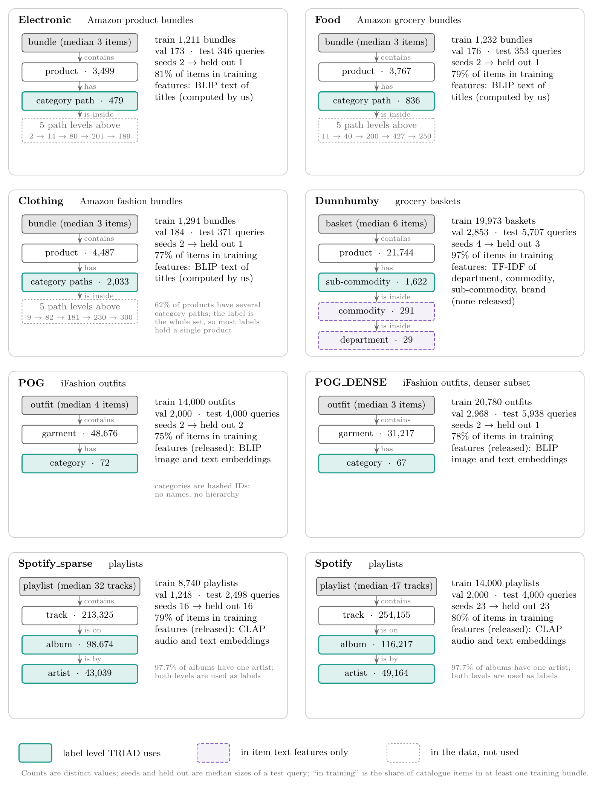
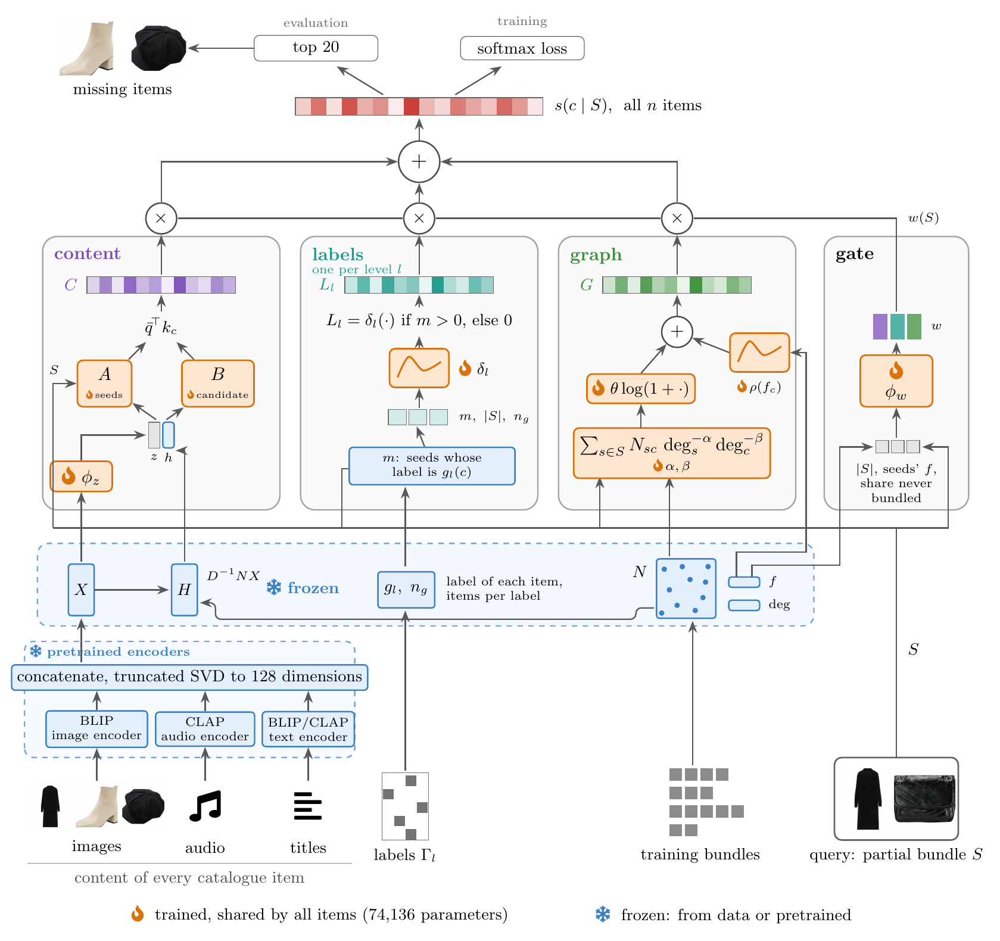

# How TRIAD works

This document is the technical description of the model in this repository: what each component computes, its
shapes, its starting values, how it is trained and evaluated, and where it lives in the code. `TRIAD_DESIGN.md` builds
the same model step by step from the simple scorer and reads what each part learned.

1. [The task](#1-the-task)
2. [The data: how each dataset is organized](#2-the-data-how-each-dataset-is-organized)
3. [The architecture at a glance](#3-the-architecture-at-a-glance)
4. [Notation and the matrices everything is built from](#4-notation-and-the-matrices-everything-is-built-from)
5. [The score, and where it starts](#5-the-score-and-where-it-starts)
6. [Term 1: content](#6-term-1-content)
7. [Term 2: labels](#7-term-2-labels)
8. [Term 3: co-occurrence graph](#8-term-3-co-occurrence-graph)
9. [The gate](#9-the-gate)
10. [Training](#10-training)
11. [Keeping training free of leakage](#11-keeping-training-free-of-leakage)
12. [Evaluation](#12-evaluation)
13. [Parameters and cost](#13-parameters-and-cost)
14. [What the trained models learn](#14-what-the-trained-models-learn)
15. [Design decisions and the evidence for them](#15-design-decisions-and-the-evidence-for-them)
16. [Code map](#16-code-map)

---

## 1. The task

A **bundle** is a set of items that belong together: an outfit, a playlist, a product set. In **bundle completion**
we see part of a bundle, the **seeds** $S$, and must rank every item in the catalogue so that the missing members come
first. Quality is measured by Recall@20 and NDCG@20 over the top 20 of the whole catalogue (section 12).

The model sees four kinds of information:

| Source | What it is | Example |
|---|---|---|
| Training bundles | lists of item IDs | 20,780 outfits on POG_DENSE |
| Item features | one vector per item | the released features only: BLIP image and text embeddings (POG), CLAP audio and text embeddings (Spotify), both from the CLHE release; where nothing is released, BLIP text embeddings of the item titles that we compute (e-commerce) |
| Item labels | one or more categorical attributes per item | category (POG, e-commerce); artist and album (Spotify) |
| Training frequency | how many training bundles contain the item | derived from the bundles |

There are no user IDs and no test information. Everything the model knows about which items go together comes from
the training bundles.

## 2. The data: how each dataset is organized

Every dataset has the same three layers: a **bundle** contains **items**, and each item carries **labels**. The
datasets differ in what those layers are, how many label levels exist, and which of them TRIAD uses.

<p align="center"></p>

Read each panel top-down: a bundle contains items, and each item has a label value at every label level. Teal boxes
are the label levels TRIAD uses (section 7). Purple dashed boxes enter only through the item's text features. Grey
dotted boxes exist in the raw data but are not used.

| Dataset | Bundle | Item | Label levels used | Split |
|---|---|---|---|---|
| Electronic, Food, Clothing | product bundle | product | 1: the category path, as one label | our seeded 70/10/20 split |
| POG, POG_DENSE | outfit | garment | 1: category | the released split files |
| Spotify_sparse, Spotify | playlist | track | 2: artist and album | the released split files |

Four features of the data shape how the model behaves:

- **The e-commerce categories are paths in a taxonomy** (Electronics › Computers & Accessories › … › Cases &
  Sleeves). TRIAD treats the whole path as one label value, so the coarser levels are not used. On Clothing, 62% of
  products have several paths, and the label is the whole set: 2,033 label values for 4,487 products. So most labels
  hold a single product, and the "same label" part of the label term rarely fires there.
- **POG's categories are hashed IDs:** 72 values, with no names and no hierarchy. Most POG targets come from a category
  that none of the seeds has (an outfit needs shoes as well as a dress), so on POG a shared category is evidence
  against a candidate (`TRIAD_DESIGN.md` §3.2).
- **Spotify has two nested levels.** 97.7% of albums have a single artist, so the album is almost a refinement of the
  artist. Both are used, each as its own label level with its own parameters.

The split also differs. POG and Spotify use the split files released with the data, so their numbers are directly
comparable with published results. The e-commerce sets have no released split, so the loaders make a
seeded one (`triad/data.py`). Query sizes follow the bundles: a typical POG query gives 2 seeds and hides 2, and a
Spotify query gives 23 tracks and hides 23.

## 3. The architecture at a glance

<p align="center"></p>

Read the figure from the bottom up:

1. **Inputs.**
2. **❄️ Frozen layer.** It is computed once from the training split, and nothing in it is trained.
3. **Three score towers.**
   - Content $C$: do the candidate's features and partners look like the seeds'?
   - Labels $L_l$, one per label level: a learned score for a candidate that shares a seed's label.
   - Graph $G$: how often the candidate was bundled with the seeds, discounted by popularity, plus a popularity prior.
4. **Gate.** Each tower is divided by its largest absolute value over the catalogue for the query, and the gate
   weights the towers per query.
5. **Weighted sum.** It gives a score for every item in the catalogue.

🔥 marks the 74,136 trained parameters. During training, a bundle's own contribution is removed from the
co-occurrence statistics before it is scored (section 11). Sections 4 to 9 define every symbol in the figure. The
figure's source is `figures/architecture.tex`.

## 4. Notation and the matrices everything is built from

| Symbol | Shape | Meaning |
|---|---|---|
| $n$ | | number of items in the catalogue |
| $d = 128$ | | feature dimension |
| $X$ | $n \times d$ | item features, each row L2-normalized (`features`) ❄️ |
| $N$ | $n \times n$, sparse | co-occurrence counts: $N_{sc}$ = number of training bundles containing both $s$ and $c$, $s \ne c$ ❄️ |
| $\deg_c = \sum_s N_{sc}$ | $n$ | co-occurrence degree of item $c$ (`history_mass`) ❄️ |
| $f_c$ | $n$ | training frequency: number of training bundles containing $c$ (`frequency`) ❄️ |
| $l$ | | a label **level**: a kind of label. POG has one (category); Spotify has two (artist, album) |
| $g$ | | one label **value** within a level, such as the category "dresses" or one artist |
| $K_l$ | | number of distinct label values at level $l$ (72 categories on POG; 49,164 artists on Spotify) |
| $g_l(c)$ | | a lookup: the label value of item $c$ at level $l$ |
| $\Gamma_l$ | $n \times K_l$ | one-hot incidence: $(\Gamma_l)_{cg} = 1$ if $g_l(c) = g$ ❄️ |
| $S$ | | the seed set of one query; $\lvert S \rvert$ its size |

$N$ is the only object built from bundles. Everything collaborative in the model is a function of $N$, $\deg$ and
$f$. `model.pair_counts` builds $N$ as sorted (source, target, count) triples plus a CSR-style pointer, so the
partners of any item are one contiguous slice.

One derived quantity is used repeatedly.

**Partner history.** For each item, the co-occurrence-weighted mean feature of its partners:

```math
H = D^{-1} N X, \qquad D = \operatorname{diag}(\deg) \qquad (n \times d;\ \text{a row is zero when } \deg = 0)
```

An item that is rarely seen has an uninformative own feature, but if it was bought with known items, $H$ says what
those were. In the code: `history_sum` $= NX$, `history()`.

**Trained parameters** are introduced with the term they belong to: the maps $A_z, A_h, B_z, B_h$ and the encoder MLP
(section 6), $\delta_l$ (section 7), $\theta$, $\alpha$, $\beta$ and $\rho$ (section 8), and the gate MLP
(section 9). Section 13 lists them all with their sizes.

## 5. The score, and where it starts

For a query with seeds $S$, every catalogue item $c$ gets

```math
s(c \mid S) \;=\; w_C(S)\, \widehat{C}(S,c) \;+\; \sum_l w_l(S)\, \widehat{L_l}(S,c) \;+\; w_G(S)\, \widehat{G}(S,c),
\qquad \widehat{T}(S,c) = \frac{T(S,c)}{\max_{c'} \lvert T(S,c') \rvert}
```

It's a weighted sum of three kinds of evidence:

- **$C$ (content):** do $c$'s features and partners look like the seeds'?
- **$L_l$ (labels):** is $c$'s category, artist or album compatible with the seeds' labels?
- **$G$ (graph):** was $c$ bundled together with the seeds, and how popular is it?

**Per-query scaling.** Each term is divided by its largest absolute value over the catalogue for this query, so every
term lies in $[-1, 1]$ and the gate weights mix terms of the same scale.

**Gate.** The weights $w(S) \ge 0$ come from a small gate that looks only at simple statistics of $S$ (section 9).
All scores for all $n$ items are computed at once as a row vector per query. A batch of $q$ queries gives a
$q \times n$ matrix (`TRIAD.forward`).

**The start.** The parameters start so that the untrained model is a simple scorer:

| Part | Start | Effect |
|---|---|---|
| Feature encoder | last layer $= 0$ | $Z = X$ |
| Content maps | $A_z = B_z = \sqrt{10}\,I_{128}$, $A_h = B_h = 0$ | $C = 10\,\bar x^\top x_c$: 10 × the cosine of the seed mean with the candidate |
| Label rule $\delta_l$ | last layer $= 0$ | $L_l = 0$ |
| Exponents, scale | $\alpha = \beta = \tfrac12$, $\theta = 1$ | cosine-normalized co-occurrence |
| Prior $\rho$ | last layer $= 0$ | no prior |
| Gate | last layer: weights 0, bias $\log(e-1)$ | $w = 1$ for every term |

So before training, $s = \widehat{C} + \widehat{G}$ with $C = 10\,\bar x^\top x_c$ and
$G = \log\big(1 + \sum_s N_{sc}/\sqrt{\deg_s \deg_c}\big)$: an equal blend of content cosine and cosine
co-occurrence. `tests/test_triad.py` checks this exactly.

## 6. Term 1: content

**What it computes.** First, the features are refined by a small residual MLP 🔥 and renormalized:

```math
Z = \operatorname{normalize}\big(X + \mathrm{MLP}(X)\big), \qquad \mathrm{MLP}: \mathbb{R}^{128} \to \mathbb{R}^{32} \to \mathbb{R}^{128}
```

The last layer of the MLP is initialized to zero, so $Z = X$ at the start.

Each item then gets a query vector (used when it is a seed) and a key vector (used when it is a candidate), both maps
of its own features $z$ and its partner history $h$ (rows of $Z$ and $H$):

```math
\mathrm{query}(s) = A_z z_s + A_h h_s, \qquad \mathrm{key}(c) = B_z z_c + B_h h_c, \qquad A_z, A_h, B_z, B_h \in \mathbb{R}^{128 \times 128}
```

The four maps $A_z, A_h, B_z, B_h$ are trained 🔥. The seeds' query vectors are averaged, and the content score is an
inner product:

```math
\varphi(S) = \frac{1}{\lvert S \rvert} \sum_{s \in S} \mathrm{query}(s), \qquad C(S,c) = \varphi(S)^\top \mathrm{key}(c)
= \bar z^\top M_{zz} z_c + \bar z^\top M_{zh} h_c + \bar h^\top M_{hz} z_c + \bar h^\top M_{hh} h_c ,
```

with $M_{ab} = A_a^\top B_b$ ($128 \times 128$) and $\bar z$, $\bar h$ the seed means. For all candidates at once this
is one matrix product, $\varphi(S)^\top \big(Z B_z^\top + H B_h^\top\big)^\top$. The $n \times 128$ key matrix is computed
once per evaluation pass and reused, together with $Z$, $H$ and the prior (`cache()`).

**Why this form.**
- **Two maps instead of one similarity.** $M_{zz} = A_z^\top B_z$ can be any matrix, so "items that complete $s$" need
  not be "items similar to $s$". At the start, $M_{zz} = 10I$: plain similarity.
- **Partner history.** It lets an item's collaborative context enter through a fixed $d$-dimensional summary, with no
  per-item embedding table, and it scores never-bundled candidates through what the seeds were bundled with.
- **Full rank.** The maps are $128 \times 128$, so the starting similarity uses all 128 feature directions.

## 7. Term 2: labels

There is one label term per label **level** $l$, each with its own parameters: one level on Electronic and POG
(the category), two on Spotify (artist and album). Within a level, $g$ ranges over the label **values**, and $g_l(c)$
is the value item $c$ has. The term needs three numbers per query and candidate:

| Symbol | Meaning |
|---|---|
| $t_l(S) = \Gamma_l^\top \mathbf{1}_S \in \mathbb{R}^{K_l}$ | how many seeds carry each label value: $t_l(S)_g = \#\{s \in S : g_l(s) = g\}$ |
| $m = t_l(S)_{g_l(c)}$ | how many seeds share the candidate's label value |
| $n_{g_l(c)}$ | how many catalogue items carry that label value |

**The score 🔥.** A tiny MLP $\delta_l$ ($3 \to 16 \to 1$) scores a candidate that shares a seed's label value. It
fires only when $m > 0$, and its last layer starts at zero, so $L_l = 0$ before training:

```math
L_l(S,c) = \delta_l\big(\log(1+m),\ \log\lvert S\rvert,\ \log(1+n_{g_l(c)})\big)\,\mathbf{1}[m>0]
```

Its output can be positive or negative, so the model decides from data whether a shared label is good (same artist
on a playlist) or bad (a second pair of shoes in an outfit). Its inputs let that depend on how many seeds share the
label, on the query size, and on how common the label is. Labels are fixed attributes of the items, not counts from
bundles, so this term needs no correction against leakage (section 11).

**What the term does not model: which labels go with which.** "Trousers go with shirts" is a relation between two
different labels. TRIAD has no separate part for it. The co-occurrence graph (section 8) already holds it at the level
of items: a label-by-label table $\Gamma_l^\top N \Gamma_l$ is $N$ summed over items, so it carries less detail than
$N$ itself. Section 15 gives the measurements behind this choice.

## 8. Term 3: co-occurrence graph

The most direct evidence is how often $c$ was bundled with the seeds. Each count is discounted by both endpoints'
degrees with learned exponents, summed over the seeds, and damped:

```math
G(S,c) \;=\; \theta \,\log\!\Big(1 + \sum_{s\in S} N_{sc}\, \deg_s^{-\alpha}\, \deg_c^{-\beta}\Big) \;+\; \rho\big(\log(1+f_c)\big)
```

- **$\alpha$ and $\beta$** 🔥 learn how much to discount popular seeds and popular candidates. They start at
  $\tfrac12$, the symmetric normalization $D^{-1/2} N D^{-1/2}$ (cosine); $0$ would be raw counts and $1$ lift.
- **$\log(1+\cdot)$** stops one very frequent pair from dominating the whole score.
- **$\rho$** 🔥 is a small MLP ($1 \to 16 \to 1$) of the candidate's training frequency, a learned popularity prior.
  It starts at 0 (last layer zero) and can become non-monotone.
- **$\theta$** 🔥 scales the term; it starts at 1.

Computing it touches only the observed partners of the seeds: the cost is $\sum_{s\in S}\deg_s$ nonzeros, not $n$
(`graph_scores`, `expand`).

## 9. The gate

How much to trust each term depends on the query. A query whose seeds were never seen in training has no graph
evidence, and a large query has more reliable label statistics. The gate maps three numbers about $S$ through a
small MLP 🔥 ($3 \to 16 \to 2 + \text{number of label levels}$) and a softplus:

```math
u(S) = \Big(\log\lvert S\rvert,\ \ \frac{1}{\lvert S\rvert}\sum_{s\in S}\log(1+f_s),\ \ \frac{\#\{s\in S: f_s = 0\}}{\lvert S\rvert}\Big),
\qquad w(S) = \operatorname{softplus}\big(\mathrm{MLP}(u(S))\big) \ge 0
```

The output has one weight per term: $w_C$ for content, $w_l$ for each label level $l$, and $w_G$ for graph. That is 3
weights on the datasets with one label level and 4 on Spotify (artist and album). The last layer starts at zero weight
with bias $\log(e-1)$, so softplus $= 1$ and every term starts with weight 1. The weights depend only on $S$, so every
candidate of a query is scored with the same weights.

## 10. Training

**Examples.** Each step takes 32 training bundles. For each bundle $b$, its items are shuffled and split into
visible seeds $S$ and hidden targets $T$. With probability ½ the cut is at the middle, otherwise at a uniformly
random point, with at least one item on each side (`train.hide`). Varying the cut trains the model for queries of
every size.

**Loss.** Every catalogue item outside the bundle is a negative. For a hidden item $j$:

```math
\mathrm{LSE} = \log \sum_{c \notin b} e^{\,s(c\mid S)}, \qquad
\ell = \frac{1}{\lvert T\rvert}\sum_{j\in T} \operatorname{softplus}\big(\mathrm{LSE} - s(j\mid S)\big)
= -\frac{1}{\lvert T\rvert}\sum_{j\in T}\log\sigma\big(s(j\mid S) - \mathrm{LSE}\big)
```

This is a full-catalogue softmax with no negative sampling. Seeds and the other hidden items are excluded from the
negatives, because they are positives too (`train.loss`).

**Optimization.** AdamW with two groups: learning rate $10^{-2}$ for the small relation parameters ($\delta_l$,
$\alpha$, $\beta$, $\theta$, $\rho$, gate) and $10^{-3}$ for the content maps and encoder. Weight decay is $10^{-3}$
for both, and gradients are clipped to norm 5. On the three small e-commerce sets (about 1,200 training bundles) both
learning rates are halved (section 15).

**Model selection.** Validation NDCG@20 is measured before training (epoch 0, the simple scorer) and after every
epoch. The best epoch is kept, including epoch 0, and training stops after 6 epochs without improvement or at 100
epochs.

**Determinism.** Fixed seeds, `torch.use_deterministic_algorithms(True)` on the CPU and single-threaded BLAS (set when
`triad` is imported) make a CPU run bit-reproducible. Interrupted runs resume from `last.pt`. `--device cuda` trains on
a GPU, where some scatter operations are not deterministic.

All settings live in `train.CONFIG` and `train.config_for`.

## 11. Keeping training free of leakage

During training, the bundle $b$ being scored is itself part of $N$, $\deg$, $f$ and $H$. Without care, the model
would be rewarded for reading the answer: $c$ was bought with the seeds because of this very bundle. At test time the
query's bundle is not in the training data, so what the model learned this way would not transfer.

**Leave-one-out (exact).** When $b$ is scored, its own contribution is subtracted from everything it touched:

| Quantity | Training value for bundle $b$ |
|---|---|
| counts | $N_{sc} - 1$ for $s, c$ both in $b$ |
| degrees | $\deg_s - (\lvert b\rvert - 1)$ for $s \in b$; the same for candidates $c \in b$ |
| frequency | $f_c - 1$ for $c \in b$ (popularity prior and gate) |
| partner history | $h_s$ recomputed without $b$'s partners, for seeds and for $b$'s members as candidates |

These are cheap corrections on the touched rows, not a rebuild of $N$ (`loo_history`, the `bundles is not None`
branches in `graph_scores` and `content_scores`).

The label term needs no correction: it reads only the items' labels, which do not depend on any bundle.

## 12. Evaluation

For each test query, the model scores the whole catalogue. Seeds are removed, and the top 20 are taken; exact ties
go to the lower item ID, so results do not depend on batching (`evaluate.top_items`). With $T$ the hidden items and
$\mathrm{hit}_k = 1$ if the $k$-th ranked item is in $T$:

```math
\mathrm{Recall@20} = \frac{1}{\lvert T\rvert}\sum_{k=1}^{20}\mathrm{hit}_k, \qquad
\mathrm{NDCG@20} = \frac{\sum_{k=1}^{20} \mathrm{hit}_k / \log_2(k+1)}{\sum_{k=1}^{\min(\lvert T\rvert,\,20)} 1/\log_2(k+1)}
```

The metrics are averaged over queries and then over seeds 0, 1 and 2.

- **Clean test queries.** In the supplied POG and Spotify splits, a few test bundles also occur, complete, in
  training or validation. Results are reported on the queries without such overlap; `Dataset.clean_test` lists them.
- **E-commerce data.** The Electronic, Food and Clothing splits are made by `data.load_resplit`, which removes
  duplicate bundles first, so every test query is clean.

## 13. Parameters and cost

With $d = 128$ and an encoder of width 32, the parameter count is the same on every dataset:

| Component | | Shape | Parameters |
|---|---|---|---:|
| Content maps $A_z, B_z, A_h, B_h$ | 🔥 | $4 \times (128 \times 128)$ | 65,536 |
| Feature encoder | 🔥 | $128 \to 32 \to 128$ | 8,352 |
| Same-label score $\delta_l$ | 🔥 | $3 \to 16 \to 1$ per level | 81 per level |
| Degree exponents $\alpha, \beta$ and scale $\theta$ | 🔥 | | 3 |
| Popularity prior $\rho$ | 🔥 | $1 \to 16 \to 1$ | 49 |
| Gate | 🔥 | $3 \to 16 \to (2 + \text{number of label levels})$ | 115 (one level) or 132 (two) |
| **Total trainable** | | | **74,136** (one level) / **74,234** (Spotify: artist and album) |
| $X$, $N$, $\deg$, $f$, $H$, labels | ❄️ | grow with the catalogue | not trained; rebuilt from the data, not stored in checkpoints |

There are no per-item or per-label embeddings, so the trainable part does not grow with the catalogue. A
254,000-item catalogue uses the same 74,234 parameters as a 3,500-item one. Only the frozen data grows.

**Costs:**

| Cost | What it involves | Measured |
|---|---|---|
| Setup, once | pair counts ($\sum_b \lvert b\rvert^2$ over training bundles), degrees, frequencies and partner histories $H = D^{-1}NX$ | |
| Inference, per query | graph $\sum_{s\in S}\deg_s$, content one $128 \times n$ product, labels one lookup per item and level | 0.1 ms per query on e-commerce, 0.4 to 0.6 ms on POG, 2.7 to 3.6 ms on Spotify (4 CPU threads, test pass ÷ queries) |
| Training, one seed | | seconds on e-commerce, about an hour on POG (CPU), one to two hours on Spotify (one GPU) |

## 14. What the trained models learn

`TRIAD_DESIGN.md` §3 reads each learned part on validation queries: the pattern it latched onto, the evidence in the
trained parameters, and how much validation NDCG@20 drops when that part is removed. The analyses are in `analysis/`.

## 15. Design decisions and the evidence for them

**Start at the simple scorer.** Every learned part starts where a simple scorer stands (section 5): cosine content,
cosine-normalized counts, no label rule, no prior, equal weights. Training moves a part only when that lowers the
loss, and epoch 0 can be selected, so with little data the model stays the simple scorer. `TRIAD_DESIGN.md` reads what
each part learned from there.

**Full-rank content maps.** The maps are $128 \times 128$, so the start uses all 128 feature directions. With rank 64,
the start used only the first 64 coordinates, and in our e-commerce runs most of the gain over the simple baselines was
lost (2 significant wins in 15 e-commerce conditions, against 6 for full rank, with the earlier learning rates).

**Per-query scaling.** Without it, the gate must first learn the relative scales of a dot product, a log count and an
MLP output, and untrained small networks add noise at full weight. With it, the gate weights are mixing weights from
the first step.

**One configuration, with one exception.** The same configuration is used on every dataset, except that both learning
rates are halved on the three small e-commerce sets (about 1,200 training bundles). With the default rates the model
moved so far in its first one or two epochs that validation could not tell a good early model from a bad one: over
five seeds, test NDCG@20 on Food ranged from .425 to .488. The halved rates were chosen on validation (five seeds on
Electronic, Food and Clothing), not on test.

The next two decisions were measured during development, before the changes above.

**No second graph hop.** A tested variant added a second hop, $\theta_2 \log\big(1 + [a A']_c\big)$, where $a$ is
the vector of discounted first-hop weights and $A'$ a degree-discounted $N$ approximated by a cross-fitted rank-64
SVD. It was meant to reach partners of partners. Retrained without it (three seeds, Holm over 14 tests), test
NDCG@20 was:
- level on Electronic, Food, Clothing, POG_DENSE and Spotify_sparse;
- slightly better without it on POG (+.0007);
- .005 lower without it on full Spotify (.2865 → .2816, significant; these runs used an earlier set of item features).

Removing it drops six rank-64 SVDs of the $n \times n$ graph (about 2.5 minutes and 0.8 GB on Spotify), made POG
inference about 3× faster in our timings, and leaves one graph term to explain. It was removed on that trade-off,
accepting the Spotify cost.

**No label-to-label relation.** A tested variant added a second label part,
$\tfrac{1}{\lvert S\rvert}\, t_l(S)^\top P_l M_l\, Q_l[g_l(c)]^\top$: fixed factors $P_l, Q_l$ from a rank-16 SVD of the
normalized label co-occurrence $\Gamma_l^\top N \Gamma_l$, and a learned $16 \times 16$ matrix $M_l$. Because the SVD saw
every training bundle, training used factors cross-fitted over five folds. Retrained without that part (three seeds,
Holm over 12 tests), test NDCG@20 changed by:
- $+.004$ on Electronic (better without it, not significant), $.000$ on Food, Clothing and Spotify_sparse;
- $-.001$ on POG (not significant) and $-.002$ on POG_DENSE (.280 → .278, significant).

On items never seen in training, where the graph term has nothing to say, it did not help on any dataset. With label
ranks 4, 64 and 128 instead of 16, validation NDCG@20 stayed within ±.006 on Electronic, Food and Clothing. It was
removed on that evidence, together with the cross-fitting, the six label SVDs per level and 256 parameters per level,
accepting the POG_DENSE cost. Section 7 explains why the graph term already covers what it modelled.

**Leave-one-out without random history masking.** A tested variant also hid a random 25% of item histories during
training. Leave-one-out alone was compared with leave-one-out plus that masking on validation, and was kept.

**Full-catalogue loss.** Every non-member is a negative, so there is no sampling distribution to tune and no
mismatch between training and full-catalogue evaluation.

## 16. Code map

    triad/
      __init__.py    pins BLAS to one thread before numpy loads (bit-reproducible feature SVDs)
      data.py        Dataset; load(name): splits, features (X), labels (Γ), clean test queries
                     load_supplied: POG / Spotify supplied splits; projected_features: released modalities → 128 dims
                     load_resplit:  Electronic / Food / Clothing: deduplicate, BLIP title features, 70/10/20 split, hide half
                     load_baskets:  Dunnhumby grocery baskets (loadable, not used in the reported results)
      model.py       pair_counts (N, deg, f)
                     TRIAD: content_scores (§6), label_scores (§7), graph_scores (§8), gate_weights (§9), forward (§5)
      train.py       CONFIG, config_for; build / load; hide, loss, fit (§10)
      evaluate.py    top_items, query_metrics, evaluate, subset (§12)
      baselines.py   the simple baselines and their tuning on validation (TASK_AND_BASELINES.md)
      statistics.py  paired cluster bootstrap and sign-flip tests, Holm correction
      __main__.py    python -m triad train | test | baselines
    analysis/
      readings.py    what each learned part does: parameter readings, knock-outs, content geometry, data facts
      extra.py       the antisymmetric content part split in two; parts removed two at a time
      taste.py       the fixed taste over candidates (TRIAD_DESIGN.md §3.5)
      tables.py      the results table, the training-set-size study and the figures
    tests/           leave-one-out, metrics, golden scores, resume, start = simple scorer

The docstring at the top of `model.py` maps every buffer and parameter name to its symbol here (for example
`history_sum` is $NX$, `same_label[i]` is $\delta_l$), and comments in the code cite the sections of this guide.

Data flow for one training run:

1. `data.load` reads the splits, the features $X$, the labels and the clean test queries.
2. ❄️ `TRIAD(...)` builds $N$, $\deg$, $f$ and $H$ from the training bundles; 🔥 the parameters start at the simple
   scorer.
3. 🔥 `train.fit` scores validation at epoch 0, then each epoch runs batches of 32 bundles through hide → leave-one-out
   forward → loss → AdamW, evaluates validation NDCG@20 and keeps the best epoch.
4. The run is saved to `runs/<dataset>/seed<s>/`, and `python -m triad test` scores the test queries.
