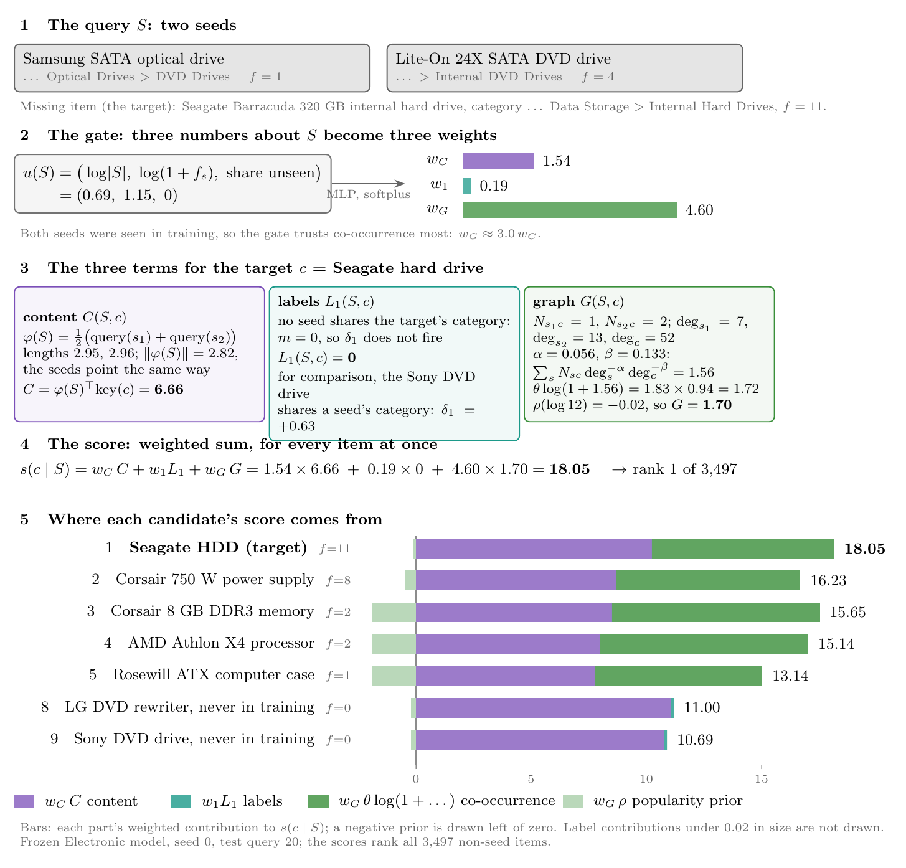

# How TRIAD works

This document explains the model in this repository from first principles. It assumes linear algebra and basic
neural-network training, but no knowledge of the repository or of earlier versions of the model. Each section says
what a component computes, why it is there, and where it lives in the code.

1. [The task](#1-the-task)
2. [The data: how each dataset is organized](#2-the-data-how-each-dataset-is-organized)
3. [The architecture at a glance](#3-the-architecture-at-a-glance)
4. [Notation and the matrices everything is built from](#4-notation-and-the-matrices-everything-is-built-from)
5. [The score in one line](#5-the-score-in-one-line)
6. [Term 1: content](#6-term-1-content)
7. [Term 2: labels](#7-term-2-labels)
8. [Term 3: co-occurrence graph](#8-term-3-co-occurrence-graph)
9. [The gate](#9-the-gate)
10. [Training](#10-training)
11. [Keeping training free of leakage](#11-keeping-training-free-of-leakage)
12. [Evaluation](#12-evaluation)
13. [Parameters and cost](#13-parameters-and-cost)
14. [What the trained models learn](#14-what-the-trained-models-learn)
15. [Design decisions and the evidence for them](#15-design-decisions-and-the-evidence-for-them)
16. [Code map](#16-code-map)

---

## 1. The task

A **bundle** is a set of items that belong together: an outfit, a playlist, a product set. In **bundle completion**
we see part of a bundle, the **seeds** $S$, and must rank every item in the catalogue so that the missing members come
first. Quality is measured by Recall@20 and NDCG@20 over the top 20 of the whole catalogue (section 12).

The model sees four kinds of information:

| Source | What it is | Example |
|---|---|---|
| Training bundles | lists of item IDs | 20,780 outfits on POG_DENSE |
| Item features | one vector per item | the released features only: BLIP image and text embeddings (POG), CLAP audio and text embeddings (Spotify), both from the CLHE release; where nothing is released, BLIP text embeddings of the item titles that we compute (e-commerce) or TF-IDF of the product text (Dunnhumby) |
| Item labels | one or more categorical attributes per item | category (POG, e-commerce); artist and album (Spotify) |
| Training frequency | how many training bundles contain the item | derived from the bundles |

There are no user IDs and no test information. Everything the model knows about which items go together comes from
the training bundles.

## 2. The data: how each dataset is organized

Every dataset has the same three layers: a **bundle** contains **items**, and each item carries **labels**. The
datasets differ in what those layers are, how many label levels exist, and which of them TRIAD uses.

<p align="center"></p>

Read each panel top-down: a bundle contains items, and each item has a label value at every label level. Teal boxes
are the label levels TRIAD uses (section 7). Purple dashed boxes enter only through the item's text features. Grey
dotted boxes exist in the raw data but are not used.

| Dataset | Bundle | Item | Label levels used | Split |
|---|---|---|---|---|
| Electronic, Food, Clothing | product bundle | product | 1: the category path, as one label | our seeded 70/10/20 split |
| Dunnhumby | grocery basket | product | 1: sub-commodity | our seeded 70/10/20 split |
| POG, POG_DENSE | outfit | garment | 1: category | the released split files |
| Spotify_sparse, Spotify | playlist | track | 2: artist and album | the released split files |

Four features of the data shape how the model behaves:

- **The e-commerce categories are paths in a taxonomy** (Electronics › Computers & Accessories › … › Cases &
  Sleeves). TRIAD treats the whole path as one label value, so the coarser levels are not used. On Clothing, 62% of
  products have several paths, and the label is the whole set: 2,033 label values for 4,487 products. So most labels
  hold a single product, and the "same label" part of the label term rarely fires there.
- **POG's categories are hashed IDs:** 72 values, with no names and no hierarchy. Most POG targets come from a category
  that none of the seeds has (an outfit needs shoes as well as a dress), so on POG a shared category is evidence
  against a candidate (section 14).
- **Spotify has two nested levels.** 97.7% of albums have a single artist, so the album is almost a refinement of the
  artist. Both are used, each as its own label level with its own parameters.
- **Dunnhumby has a three-level hierarchy** (department › commodity › sub-commodity). Only the finest level is a label;
  the two coarser ones appear only as words in the item features.

The split also differs. POG and Spotify use the split files released with the data, so their numbers are directly
comparable with published results. The e-commerce sets and Dunnhumby have no released split, so the loaders make a
seeded one (`triad/data.py`). Query sizes follow the bundles: a typical POG query gives 2 seeds and hides 2, and a
Spotify query gives 23 tracks and hides 23.

## 3. The architecture at a glance

<p align="center"></p>

Read the figure from the bottom up:

1. **Inputs.**
2. **❄️ Frozen layer.** It is computed once from the training split, and nothing in it is trained.
3. **Three score towers.**
   - Content $C$: do the candidate's features and partners look like the seeds'?
   - Labels $L_l$, one per label level: a learned score for a candidate that shares a seed's label.
   - Graph $G$: how often the candidate was bought with the seeds, discounted by popularity, plus a popularity prior.
4. **Gate.** It weights the towers per query.
5. **Weighted sum.** It gives a score for every item in the catalogue.

🔥 marks the 41,368 trained parameters. During training, a bundle's own contribution is removed from the
co-occurrence statistics before it is scored (section 11). Sections 4 to 9 define every symbol in the figure. The figure's source is `figures/architecture.tex`.

## 4. Notation and the matrices everything is built from

| Symbol | Shape | Meaning |
|---|---|---|
| $n$ | | number of items in the catalogue |
| $d = 128$ | | feature dimension |
| $X$ | $n \times d$ | item features, each row L2-normalized (`features`) ❄️ |
| $N$ | $n \times n$, sparse | co-occurrence counts: $N_{sc}$ = number of training bundles containing both $s$ and $c$, $s \ne c$ ❄️ |
| $\deg_c = \sum_s N_{sc}$ | $n$ | co-occurrence degree of item $c$ (`history_mass`) ❄️ |
| $f_c$ | $n$ | training frequency: number of training bundles containing $c$ (`frequency`) ❄️ |
| $l$ | | a label **level**: a kind of label. POG has one (category); Spotify has two (artist, album) |
| $g$ | | one label **value** within a level, such as the category "dresses" or one artist |
| $K_l$ | | number of distinct label values at level $l$ (72 categories on POG; 49,164 artists on Spotify) |
| $g_l(c)$ | | a lookup: the label value of item $c$ at level $l$ |
| $\Gamma_l$ | $n \times K_l$ | one-hot incidence: $(\Gamma_l)_{cg} = 1$ if $g_l(c) = g$ ❄️ |
| $S$ | | the seed set of one query; $\lvert S \rvert$ its size |

$N$ is the only object built from bundles. Everything collaborative in the model is a function of $N$, $\deg$ and
$f$. `model.pair_counts` builds $N$ as sorted (source, target, count) triples plus a CSR-style pointer, so the
partners of any item are one contiguous slice.

One derived quantity is used repeatedly.

**Partner history.** For each item, the co-occurrence-weighted mean feature of its partners:

```math
H = D^{-1} N X, \qquad D = \operatorname{diag}(\deg) \qquad (n \times d;\ \text{a row is zero when } \deg = 0)
```

An item that is rarely seen has an uninformative own feature, but if it was bought with known items, $H$ says what
those were. In the code: `history_sum` $= NX$, `history()`.

**Trained parameters** are introduced with the term they belong to: the maps $A_z, A_h, B_z, B_h$ and the encoder MLP
(section 6), $\delta_l$ (section 7), $\theta$, $\alpha$, $\beta$ and $\rho$ (section 8), and the gate MLP
(section 9). Section 13 lists them all with their sizes.

## 5. The score in one line

For a query with seeds $S$, every catalogue item $c$ gets

```math
s(c \mid S) \;=\; w_C(S)\, C(S,c) \;+\; \sum_l w_l(S)\, L_l(S,c) \;+\; w_G(S)\, G(S,c)
```

It's a weighted sum of three kinds of evidence:

- **$C$ (content):** do $c$'s features and partners look like the seeds'?
- **$L_l$ (labels):** is $c$'s category, artist or album compatible with the seeds' labels?
- **$G$ (graph):** was $c$ bought together with the seeds, and how popular is it?

The weights $w(S) \ge 0$ come from a small **gate** that looks only at simple statistics of $S$ (section 9). All
scores for all $n$ items are computed at once as a row vector per query. A batch of $q$ queries gives a $q \times n$
matrix (`TRIAD.forward`).

### The running example

One real query is followed through the rest of this document, with the numbers the trained model produces: Electronic
test query 20, scored by the frozen seed-0 model. The seeds are $S = \{s_1, s_2\}$, a Samsung SATA optical drive
($f_{s_1} = 1$) and a Lite-On SATA DVD drive ($f_{s_2} = 4$). The missing item, the target $c$, is a Seagate 320 GB
internal hard drive ($f_c = 11$). Electronic has one label level, the category path, so $l$ takes the single value 1.

<p align="center"></p>

The figure's panels use symbols that sections 6 to 9 define; panel 5 can be read now. Those sections compute each
piece for the target: content $C(S,c) = 6.66$, labels $L_1(S,c) = 0$, graph $G(S,c) = 1.70$, and gate weights
$w_C = 1.54$, $w_1 = 0.19$, $w_G = 4.60$. The score is their weighted sum:

```math
s(c \mid S) = w_C\, C + w_1 L_1 + w_G\, G = 1.54 \times 6.66 + 0.19 \times 0 + 4.60 \times 1.70 = 18.05
```

That is the highest of the 3,497 items that are not seeds, so the target is ranked first. Panel 5 of the figure splits
the scores of seven candidates into their weighted parts:

- **Ranks 1 to 5** are all computer parts bought with these drives: a hard drive, a power supply, memory, a processor
  and a case. Co-occurrence (dark green) and content (purple) are the two large parts for all of them.
- **The two best-ranked items never seen in training** have no co-occurrence, so content and labels must carry them.
  Both are DVD drives, like the seeds: an LG rewriter has the highest content score of all seven and ranks 8th, a Sony
  drive ranks 9th. Without co-occurrence the model finds more of what the seeds are, not what completes them. This is
  the model's main weakness: on POG, 59% of held-out test items never occur in a training bundle, and Recall@20 on
  them is .020.

The parts were extracted from the frozen model and add up to its scores to within $10^{-4}$.

## 6. Term 1: content

**What it computes.** First, the features are refined by a small residual MLP 🔥 and renormalized:

```math
Z = \operatorname{normalize}\big(X + \mathrm{MLP}(X)\big), \qquad \mathrm{MLP}: \mathbb{R}^{128} \to \mathbb{R}^{32} \to \mathbb{R}^{128}
```

The last layer of the MLP is initialized to zero, so $Z = X$ at the start.

Each item then gets a query vector (used when it is a seed) and a key vector (used when it is a candidate), both
rank-64 maps of its own features $z$ and its partner history $h$ (rows of $Z$ and $H$):

```math
\mathrm{query}(s) = A_z z_s + A_h h_s, \qquad \mathrm{key}(c) = B_z z_c + B_h h_c, \qquad A_z, A_h, B_z, B_h \in \mathbb{R}^{64 \times 128}
```

The four maps $A_z, A_h, B_z, B_h$ are trained 🔥.

The seeds' query vectors are averaged, and the content score is an inner product:

```math
\varphi(S) = \frac{1}{\lvert S \rvert} \sum_{s \in S} \mathrm{query}(s), \qquad C(S,c) = \varphi(S)^\top \mathrm{key}(c)
```

For all candidates at once this is one matrix product, $\varphi(S)^\top \big(Z B_z^\top + H B_h^\top\big)^\top$.
The $n \times 64$ key matrix is computed once per evaluation pass and reused, together with $Z$, $H$ and the
prior (`cache()`).

**In the example.** The two seeds' query vectors have lengths 2.95 and 2.96. Their mean $\varphi(S)$ has length 2.82,
almost as long as either, so the two DVD drives point in nearly the same direction. The target's key has length 2.77,
and the content score is one inner product:

```math
C(S,c) = \varphi(S)^\top \mathrm{key}(c) = 6.66
```

The LG and Sony DVD drives score higher, $C = 7.20$ and $7.00$. They are a third and a fourth DVD drive, so they look
like the seeds; the hard drive is what completes them. Ranked by content alone, the target would be only 37th; the
graph term is what moves it to first.

**Why this form.**
- **Two maps instead of one similarity (asymmetric).** "Items that complete $s$" is not "items similar to $s$": a
  shirt needs trousers, not more shirts. Separate query and key maps can learn that.
- **Partner history.** It lets an item's collaborative context enter through a fixed $d$-dimensional summary, with
  no per-item embedding table.
- **Initialization.** $A_z = B_z = \sqrt{10}\,[I_{64}\ 0]$ and $A_h = B_h = 0$, so the model starts as 10 × the dot
  product of the first 64 feature coordinates (seed mean against candidate) and learns away from it.

## 7. Term 2: labels

There is one label term per label **level** $l$, each with its own parameters: one level on Electronic and POG
(the category), two on Spotify (artist and album). Within a level, $g$ ranges over the label **values**, and $g_l(c)$
is the value item $c$ has. The term needs three numbers per query and candidate. In the running example ($l = 1$),
two candidates show both cases:

| Symbol | Meaning | Target: Seagate hard drive | Sony DVD drive |
|---|---|---|---|
| $t_l(S) = \Gamma_l^\top \mathbf{1}_S \in \mathbb{R}^{K_l}$ | how many seeds carry each label value: $t_l(S)_g = \#\{s \in S : g_l(s) = g\}$ | 1 at "… › DVD Drives", 1 at "… › Internal DVD Drives", 0 at the other 477 categories (the same for every candidate) | the same |
| $m = t_l(S)_{g_l(c)}$ | how many seeds share the candidate's label value | 0: "… › Internal Hard Drives" is no seed's category | 1: the Samsung seed's category |
| $n_{g_l(c)}$ | how many catalogue items carry that label value | 32 | 8 |

**The score 🔥.** A tiny MLP $\delta_l$ ($3 \to 16 \to 1$) scores a candidate that shares a seed's label value. It
fires only when $m > 0$:

```math
L_l(S,c) = \delta_l\big(\log(1+m),\ \log\lvert S\rvert,\ \log(1+n_{g_l(c)})\big)\,\mathbf{1}[m>0]
```

Its output can be positive or negative, so the model decides from data whether a shared label is good (same artist
on a playlist) or bad (a second pair of shoes in an outfit). Its inputs let that depend on how many seeds share the
label, on the query size, and on how common the label is. Labels are fixed attributes of the items, not counts from
bundles, so this term needs no correction against leakage (section 11).

**In the example.** For the Sony drive, $m = 1$, so the term fires: $\delta_1(\log 2,\ \log 2,\ \log 9) = +0.63$, a
bonus for sharing a seed's category. For the target, $m = 0$, so $L_1(S,c) = 0$.

**What the term does not model: which labels go with which.** "Trousers go with shirts" is a relation between two
different labels. TRIAD has no separate part for it. The co-occurrence graph (section 8) already holds it at the level
of items: a label-by-label table $\Gamma_l^\top N \Gamma_l$ is $N$ summed over items, so it carries less detail than
$N$ itself. Section 15 gives the measurements behind this choice.

## 8. Term 3: co-occurrence graph

The most direct evidence is how often $c$ was bought with the seeds. Raw counts favour popular items, so each count
is discounted by both endpoints' degrees with learned exponents, summed over the seeds, and damped:

```math
G(S,c) \;=\; \theta \,\log\!\Big(1 + \sum_{s\in S} N_{sc}\, \deg_s^{-\alpha}\, \deg_c^{-\beta}\Big) \;+\; \rho\big(\log(1+f_c)\big)
```

- **$\alpha$ and $\beta$** 🔥 (initialized to 0, which gives raw counts) learn how much to discount popular seeds
  and popular candidates. $\alpha = \beta = \tfrac12$ would be the symmetric normalization $D^{-1/2} N D^{-1/2}$
  used by many graph filters; the model picks its own.
- **$\log(1+\cdot)$** stops one very frequent pair from dominating the whole score.
- **$\rho$** 🔥 is a small MLP ($1 \to 16 \to 1$) of the candidate's training frequency, a learned popularity prior.
  It can be non-monotone, for example to penalize items seen once.
- **$\theta$** 🔥 scales the term.

Computing it touches only the observed partners of the seeds: the cost is $\sum_{s\in S}\deg_s$ nonzeros, not $n$
(`graph_scores`, `expand`).

**In the example.** The target was bought with the first seed once and with the second twice: $N_{s_1c} = 1$ and
$N_{s_2c} = 2$. The degrees are $\deg_{s_1} = 7$, $\deg_{s_2} = 13$ and $\deg_c = 52$. The trained model has
$\alpha = 0.056$, $\beta = 0.133$ and $\theta = 1.83$:

```math
\sum_{s\in S} N_{sc}\,\deg_s^{-\alpha}\deg_c^{-\beta} = 1\cdot 7^{-0.056}\cdot 52^{-0.133} + 2\cdot 13^{-0.056}\cdot 52^{-0.133} = 0.530 + 1.025 = 1.56
```

```math
G(S,c) = \theta\log(1 + 1.56) + \rho\big(\log(1 + 11)\big) = 1.83 \times 0.94 - 0.02 = 1.72 - 0.02 = 1.70
```

The prior $\rho$ is not monotone in this model. It gives $-0.04$ at $f = 0$, $-0.41$ at $f = 1$ and $f = 2$,
$-0.28$ at $f = 4$, $-0.10$ at $f = 8$ and $-0.02$ at $f = 11$: items seen only once or twice are pushed down most.
The LG and Sony DVD drives were never in a training bundle, so their sum is 0 and only the prior is left.

## 9. The gate

How much to trust each term depends on the query. A query whose seeds were never seen in training has no graph
evidence, and a large query has more reliable label statistics. The gate maps three numbers about $S$ through a
small MLP 🔥 ($3 \to 16 \to 2 + \text{number of label levels}$) and a softplus:

```math
u(S) = \Big(\log\lvert S\rvert,\ \ \frac{1}{\lvert S\rvert}\sum_{s\in S}\log(1+f_s),\ \ \frac{\#\{s\in S: f_s = 0\}}{\lvert S\rvert}\Big),
\qquad w(S) = \operatorname{softplus}\big(\mathrm{MLP}(u(S))\big) \ge 0
```

The output has one weight per term: $w_C$ for content, $w_l$ for each label level $l$, and $w_G$ for graph. That is
3 weights on the datasets with one label level ($w_C, w_1, w_G$) and 4 on Spotify, whose two levels are artist and
album ($w_C, w_1, w_2, w_G$). The last layer starts at zero weight with
bias $\log(e-1)$, so softplus $= 1$ and every term starts with weight 1.

**In the example.** The two seeds have $f = 1$ and $f = 4$, so

```math
u(S) = \Big(\log 2,\ \tfrac12\big(\log 2 + \log 5\big),\ 0\Big) = (0.69,\ 1.15,\ 0)
```

and the gate returns $w_C = 1.54$, $w_1 = 0.19$, $w_G = 4.60$. Both seeds were seen in training (the third statistic
is 0), so co-occurrence gets the largest weight, 3.0 times that of content. The weights depend only on $S$, so every
candidate is scored with these same three numbers.

## 10. Training

**Examples.** Each step takes 32 training bundles. For each bundle $b$, its items are shuffled and split into
visible seeds $S$ and hidden targets $T$. With probability ½ the cut is at the middle, otherwise at a uniformly
random point, with at least one item on each side (`train.hide`). Varying the cut trains the model for queries of
every size.

**Loss.** Every catalogue item outside the bundle is a negative. For a hidden item $j$:

```math
\mathrm{LSE} = \log \sum_{c \notin b} e^{\,s(c\mid S)}, \qquad
\ell = \frac{1}{\lvert T\rvert}\sum_{j\in T} \operatorname{softplus}\big(\mathrm{LSE} - s(j\mid S)\big)
= -\frac{1}{\lvert T\rvert}\sum_{j\in T}\log\sigma\big(s(j\mid S) - \mathrm{LSE}\big)
```

This is a full-catalogue softmax with no negative sampling. Seeds and the other hidden items are excluded from the
negatives, because they are positives too (`train.loss`).

**Optimization.** AdamW with two groups: learning rate $10^{-2}$ for the small relation parameters ($\delta_l$,
$\alpha$, $\beta$, $\theta$, $\rho$, gate) and $10^{-3}$ for the content maps and encoder. Weight decay
is $10^{-3}$ for both, and gradients are clipped to norm 5.

**Model selection.** After every epoch, NDCG@20 is measured on the validation queries. The best epoch is kept, and
training stops after 6 epochs without improvement or at 100 epochs.

**Determinism.** Fixed seeds, `torch.use_deterministic_algorithms(True)` and single-threaded BLAS (set when `triad`
is imported) make a run bit-reproducible. Interrupted runs resume from `last.pt`.

All settings live in `train.CONFIG`; nothing is tuned per dataset.

## 11. Keeping training free of leakage

During training, the bundle $b$ being scored is itself part of $N$, $\deg$, $f$ and $H$. Without care, the model
would be rewarded for reading the answer: $c$ was bought with the seeds because of this very bundle. At test time the
query's bundle is not in the training data, so what the model learned this way would not transfer.

**Leave-one-out (exact).** When $b$ is scored, its own contribution is subtracted from everything it touched:

| Quantity | Training value for bundle $b$ |
|---|---|
| counts | $N_{sc} - 1$ for $s, c$ both in $b$ |
| degrees | $\deg_s - (\lvert b\rvert - 1)$ for $s \in b$; the same for candidates $c \in b$ |
| frequency | $f_c - 1$ for $c \in b$ (popularity prior and gate) |
| partner history | $h_s$ recomputed without $b$'s partners, for seeds and for $b$'s members as candidates |

These are cheap corrections on the touched rows, not a rebuild of $N$ (`loo_history`, the `bundles is not None`
branches in `graph_scores` and `content_scores`).

The label term needs no correction: it reads only the items' labels, which do not depend on any bundle.

## 12. Evaluation

For each test query, the model scores the whole catalogue. Seeds are removed, and the top 20 are taken; exact ties
go to the lower item ID, so results do not depend on batching (`evaluate.top_items`). With $T$ the hidden items and
$\mathrm{hit}_k = 1$ if the $k$-th ranked item is in $T$:

```math
\mathrm{Recall@20} = \frac{1}{\lvert T\rvert}\sum_{k=1}^{20}\mathrm{hit}_k, \qquad
\mathrm{NDCG@20} = \frac{\sum_{k=1}^{20} \mathrm{hit}_k / \log_2(k+1)}{\sum_{k=1}^{\min(\lvert T\rvert,\,20)} 1/\log_2(k+1)}
```

The metrics are averaged over queries and then over seeds 0, 1 and 2.

- **Clean test queries.** In the supplied POG and Spotify splits, a few test bundles also occur, complete, in
  training or validation. Results are reported on the queries without such overlap; `Dataset.clean_test` lists them.
- **E-commerce data.** The Electronic, Food and Clothing splits are made by `data.load_resplit`, which removes
  duplicate bundles first, so every test query is clean.

## 13. Parameters and cost

With $d = 128$, rank 64 and hidden 32, the parameter count is the same on every dataset:

| Component | | Shape | Parameters |
|---|---|---|---:|
| Content maps $A_z, B_z, A_h, B_h$ | 🔥 | $4 \times (64 \times 128)$ | 32,768 |
| Feature encoder | 🔥 | $128 \to 32 \to 128$ | 8,352 |
| Same-label score $\delta_l$ | 🔥 | $3 \to 16 \to 1$ per level | 81 per level |
| Degree exponents $\alpha, \beta$ and scale $\theta$ | 🔥 | | 3 |
| Popularity prior $\rho$ | 🔥 | $1 \to 16 \to 1$ | 49 |
| Gate | 🔥 | $3 \to 16 \to (2 + \text{number of label levels})$ | 115 (one level) or 132 (two) |
| **Total trainable** | | | **41,368** (one level) / **41,466** (Spotify: artist and album) |
| $X$, $N$, $\deg$, $f$, $H$, labels | ❄️ | grow with the catalogue | not trained; rebuilt from the data, not stored in checkpoints |

There are no per-item or per-label embeddings, so the trainable part does not grow with the catalogue. A
254,000-item catalogue uses the same 41,466 parameters as a 3,500-item one. Only the frozen data grows.

**Costs:**

| Cost | What it involves | Measured |
|---|---|---|
| Setup, once | pair counts ($\sum_b \lvert b\rvert^2$ over training bundles), degrees, frequencies and partner histories $H = D^{-1}NX$ | |
| Inference, per query | graph $\sum_{s\in S}\deg_s$, content one $64 \times n$ product, labels one lookup per item and level | 0.2 ms per query on e-commerce, 0.4–0.5 ms on POG, 2.5–5.4 ms on Spotify (4 CPU threads, test pass ÷ queries) |
| Training, one seed | | seconds on e-commerce, about an hour on POG, a few hours on Spotify (one thread) |

## 14. What the trained models learn

The values below are averaged over the three seeds; the gate weights are averaged over the first 512 validation
queries. $\delta$ is evaluated for one of three seeds sharing the candidate's label, at the median label size
(`paper/figdata/learned.py`).

| Dataset | $\theta$ | $\alpha$ | $\beta$ | Gate weight: content / labels / graph | $\delta$ for one of 3 seeds sharing $c$'s label |
|---|---:|---:|---:|---|---|
| Electronic | 1.87 | .06 | .13 | 1.89 / 0.63 / 4.94 | +0.21 (category) |
| Food | 1.63 | −.05 | −.06 | 2.13 / 0.87 / 4.05 | +1.00 |
| Clothing | 1.68 | −.07 | −.18 | 2.58 / 1.06 / 5.72 | +1.27 |
| POG_DENSE | 4.84 | .41 | .36 | 5.68 / 0.45 / 2.96 | **−22.5** |
| POG | 2.95 | .29 | .28 | 3.83 / 1.00 / 2.94 | **−6.17** |
| Spotify_sparse | 0.83 | −.07 | −.05 | 3.05 / 1.23, 1.27 / 0.82 | +1.88 (artist), +1.17 (album) |
| Spotify | 1.10 | .33 | −.30 | 3.08 / 0.92, 1.07 / 1.10 | +1.87 (artist), +1.20 (album) |

- **On POG outfits, a shared category is penalized strongly.** An outfit needs one item per category, so "same
  category as a seed" is evidence against: weighted by the gate, a candidate in a seed's category loses about 10 points
  on POG_DENSE, more than any other term adds. Nothing in the model says this; the sign of $\delta$ is learned.
- **On playlists, a shared artist or album is rewarded.** On the e-commerce sets a shared category is rewarded too:
  their bundles group related products.
- **The degree exponents differ by domain.** POG learns to discount popular items on both sides
  ($\alpha, \beta \approx .3$–$.4$). Spotify_sparse and the e-commerce sets keep nearly raw counts, with a slight
  preference for popular candidates ($\beta < 0$) on Clothing; on Food the sign changes from seed to seed. Full
  Spotify discounts popular seeds ($\alpha = .33$) and favours popular candidates ($\beta = -.30$).

### Reading the parameters

Do the trained values mean something, or are they just numbers that happen to fit? For each part of the model we
compare what it learned with a quantity measured directly from the data. Everything here uses the first 512
validation queries of seeds 0, 1 and 2, never test (`paper/figdata/parameters.py`, which writes
`parameters.json`). These measurements describe what each part encodes; the ablations (§15) test whether it helps.

**$\rho$ learns the base rate of targets by popularity.** The loss is a softmax over the whole catalogue. If the
only score were a function of an item's training frequency $f$, the best such score would be the *base rate*

$$b(f) = \log\frac{\text{share of targets with frequency } f}{\text{share of catalogue items with frequency } f},$$

up to a constant, since a softmax ignores a shift of all scores. So the test is whether the weighted prior
$w_G\,\rho(\log(1+f))$ has the shape of $b(f)$. Items are grouped into frequency bins (0, 1, 2, 3–4, 5–9, 10–19,
20–49, 50+), keeping bins with at least 20 items and 20 targets.

| | Electronic | Food | Dunnhumby | POG_DENSE | POG | Spotify_sparse | Spotify |
|---|---:|---:|---:|---:|---:|---:|---:|
| Bins | 3 | 3 | 8 | 8 | 7 | 8 | 8 |
| corr($w_G\rho$, $b$) over bins | .97–.99 | .95–.97 | .97–.99 | .99 | 1.00 | .93–.95 | .67–.71 |

Clothing has only two bins (f = 0 and 1), so no correlation is given for it. Example, POG seed 0: from $f=0$ to
$f=1$ the base rate falls by 2.27 and $w_G\rho$ by 2.03; from $f=1$ to $f=20$–49 the base rate rises by 4.59 and
$w_G\rho$ by 4.13. On full Spotify the fit is weaker because the graph term already carries popularity there
(next paragraph): $\rho$ stays nearly flat and $\beta < 0$ does the work.

**Unseen items are more likely targets than items seen once.** On every dataset the base rate is higher at $f=0$
than at $f=1$ (by 1.4–2.3 on e-commerce, POG and Spotify; by .4 on Dunnhumby). The reason is how a catalogue is
built: it holds every item of any bundle, so an item with $f=0$ is in the catalogue only because some validation or
test bundle contains it. $\rho$ learns this gap on the e-commerce sets, Dunnhumby and POG (on Clothing it is 3.1,
twice the base-rate gap); on Spotify it learns little of it (.04 and .29). No test label is used: leave-one-out
training produces the same situation from training bundles alone (an item seen once has $f=0$ once its bundle is
left out). But the model does use the fact that the catalogue lists the held-out items, which is standard in these
datasets and is worth stating when results are compared.

**How backpropagation learns the bonus.** $\rho$ is one shared curve of $\log(1+f)$, not a parameter per item, so
its value at $f=0$ is pushed by every training target and every negative that has $f=0$. Under leave-one-out, a
training target that occurs in no other training bundle has $f=0$ (14–64% of training targets, 45% on Electronic);
it pushes $\rho(0)$ up. Every $f=0$ item outside the bundle is a softmax negative and pushes it down; in these
catalogues those are the validation- and test-only items. The gradient on $\rho(0)$ is (softmax mass on $f=0$ items)
minus [target has $f=0$], and it settles where the two balance: the training base-rate gap, 1.3–2.2, within .25 of the
test gap on every dataset. On Electronic the bonus $w_G(\rho(0)-\rho(\log 2))$ is +2.0 after one epoch and stays
1.2–2.0 over 30 epochs without early stopping.

**It follows the catalogue, not the split** (RESULTS.md §2a; bundlefuse `experiments/catalogue_check/run.py`). On
two fresh splits of Electronic and Food the bonus stays 1.4–1.8 and adds .017–.042 NDCG@20. Adding $P = 1, 4, 16
\times n_0$ never-bundled items (copies of real items' features and categories) lowers the test base-rate value by
$\log(1+P/n_0)$; the learned bonus follows it from training alone, turns into a penalty at $16n_0$ ($-0.63$
Electronic, $-1.05$ Food), and its gain at test falls to zero from $4n_0$ on. Because the payoff depends on the
catalogue, the paper gives the simple baselines the same prior and reports TRIAD without the bonus ($\rho(0)$ replaced
by $\rho(\log 2)$ at test time).

**The degree exponents: readable on four datasets, not identified on two.** A count $N_{sc}$ is multiplied by
$\deg_s^{-\alpha}\deg_c^{-\beta}$. The size of that factor at the 90th-percentile degree (range over seeds):

| Dataset | 90th-pct degree | $\alpha$ | $\beta$ | Busy candidate | Busy seed |
|---|---:|---:|---:|---:|---:|
| POG_DENSE | 10 | .40–.41 | .35–.36 | ×0.44 | ×0.39 |
| POG | 6 | .26–.34 | .23–.33 | ×0.56–0.67 | ×0.55–0.63 |
| Spotify | 697 | .31–.35 | −.28 to −.32 | ×6.1–7.9 | ×0.10–0.13 |
| Dunnhumby | 134 | .13–.14 | −.11 | ×1.7 | ×0.50–0.54 |
| Electronic | 11 | .06 | .13 | ×0.73 | ×0.87 |
| Clothing | 9 | −.02 to −.16 | −.17 to −.19 | ×1.4–1.5 | ×1.0–1.4 |
| Food | 10 | −.16 to .04 | −.22 to .05 | sign changes | sign changes |
| Spotify_sparse | 347 | −.04 to −.09 | −.02 to −.07 | ×1.1–1.5 | ×1.2–1.7 |

On POG, busy items are discounted on both sides, much like the normalization in RP3β. On Spotify, a hit song as a
seed says little about a playlist (×0.1), but hits are likely candidates (×7), which is why $\rho$ can stay flat
there. On Dunnhumby, popular groceries are favoured as candidates and discounted as seeds, the same pattern in milder
form. On Food the sign changes between seeds, and on Spotify_sparse the values are small and vary: there the
exponents are not pinned down by the data and should not be read. On the e-commerce sets degrees are small (about 10
at the 90th percentile), so the exponents matter little in any case.

**The gate moves weight to content when the seeds are unseen.** The gate maps three query statistics to one weight
per term. Varying one statistic around the median validation query (seed 0; for content the other seeds agree in direction except
on Dunnhumby, while changes in the label and graph weights smaller than about .5 do not always keep their direction across seeds):

| Share of unseen seeds 0 → 1 | Content | Labels | Graph |
|---|---|---|---|
| Electronic | 1.76 → 2.10 | 0.23 → 0.26 | 5.78 → 5.70 |
| Food | 2.12 → 2.62 | 0.63 → 0.90 | 4.96 → 4.69 |
| Clothing | 2.12 → 2.90 | 0.85 → 0.90 | 4.52 → 6.47 |
| Dunnhumby | 1.47 → 1.79 | 0.62 → 0.37 | 0.93 → 0.85 |
| POG_DENSE | 5.54 → 7.61 | 0.63 → 0.66 | 3.26 → 4.15 |
| POG | 2.83 → 3.84 | 1.15 → 0.91 | 2.39 → 2.16 |
| Spotify_sparse | 3.18 → 4.90 | artist 0.99 → 1.50, album 1.09 → 2.00 | 0.85 → 0.63 |
| Spotify | 3.21 → 5.10 | artist 0.73 → 1.35, album 0.91 → 2.00 | 1.13 → 0.73 |

An unseen seed has no co-occurrence counts and no partner history, so its evidence can only come from its features
and labels. The content weight rises with the share of unseen seeds on seven datasets in every seed; on Dunnhumby it
is flat (seeds 1 and 2: 1.36 → 1.38 and 1.42 → 1.34). On Spotify both label weights rise as well and the graph weight
falls. On Clothing and POG_DENSE the graph weight rises instead: with unseen seeds the graph term is mostly the
prior $\rho$, which then carries more weight. The content weight also grows with $|S|$ (POG: 5.3 at
$|S|=2$, 12.8 at $|S|=20$). Part of that is rescaling, since the mean of more seed vectors is shorter, so it is not
read as meaning.

**The content maps: near title similarity on e-commerce, a new relation on POG and Spotify.** The content score is
the sum of four blocks,

$$C = \bar z^\top (A_z^\top B_z) z_c + \bar z^\top (A_z^\top B_h) h_c + \bar h^\top (A_h^\top B_z) z_c + \bar h^\top (A_h^\top B_h) h_c,$$

called zz, zh, hz and hh. zz asks "do the seeds look like the candidate?" and zh asks "do the seeds look like the
items the candidate is usually bundled with?", which is a complement signal. The table gives how much each block
moves the scores within each query's top 100 (standard deviation, gate weight included), and how far
$A_z^\top B_z$ moved from its start $10\,[I_{64}\ 0;\ 0\ 0]$ (range over seeds):

| | zz | zh | hz | hh | Change of $A_z^\top B_z$ | Share outside the first 64 dims | cos($z$, $x$) |
|---|---:|---:|---:|---:|---:|---:|---:|
| Electronic, Food, Clothing | .89–1.26 | .06–.20 | .02–.06 | ≤.01 | 11–27% | 0.3–2.2% | .78–.92 |
| Dunnhumby | .66–.67 | .14–.16 | .12–.14 | .09–.10 | 56–58% | 12% | .62–.64 |
| POG_DENSE | .49–.56 | .32–.37 | .36–.42 | .37–.42 | 80–100% | 23–32% | .83–.86 |
| POG | .54–.60 | .19–.24 | .14–.18 | .13–.16 | 63–91% | 14–28% | .79–.82 |
| Spotify_sparse | .53–.54 | .55–.60 | .16–.21 | .13–.20 | 39–49% | 5–9% | .60–.63 |
| Spotify | .46 | .32–.35 | .21–.24 | .10–.17 | 45–61% | 7–13% | .60–.66 |

On e-commerce, content stays close to "similar title": the map moves little from its start, stays in the first 64
dimensions, and the history blocks add little. On POG_DENSE the map is largely rebuilt and uses dimensions it started
without, and all four blocks matter: the model learns which looks go together, not which look alike, which is what an
outfit needs. On Spotify_sparse, "sounds like the candidate's usual neighbours" (zh) moves the shortlist as much as
"sounds like the candidate" (zz).

**The label penalty on POG works as a hard rule.** On POG and POG_DENSE the spread of the label term over the top 100
is 0 (at most .003): every candidate that shares a seed's category is pushed out of the top 100, so the shortlist
contains no repeated category. On Spotify the artist term moves the shortlist more than the album term (.66–1.00 vs
.35–.54).

## 15. Design decisions and the evidence for them

**One fixed configuration.** A single configuration was used on all eight datasets, with no per-dataset tuning. The
e-commerce datasets were never used while the model was developed.

**No second graph hop.** An earlier version added a second hop, $\theta_2 \log\big(1 + [a A']_c\big)$, where $a$ is
the vector of discounted first-hop weights and $A'$ a degree-discounted $N$ approximated by a cross-fitted rank-64
SVD. It was meant to reach partners of partners. Retrained without it (three seeds, Holm over 14 tests), test
NDCG@20 was:
- level on Electronic, Food, Clothing, POG_DENSE and Spotify_sparse;
- slightly better without it on POG (+.0007);
- .005 lower without it on full Spotify (.2865 → .2816, significant; these runs used the earlier item features, RESULTS.md section 6).

Removing it drops six rank-64 SVDs of the $n \times n$ graph (about 2.5 minutes and 0.8 GB on Spotify), made POG
inference about 3× faster in our timings, and leaves one graph term to explain. It was removed on that trade-off,
accepting the Spotify cost.

**No label-to-label relation.** An earlier version, DIALS, added a second label part,
$\tfrac{1}{\lvert S\rvert}\, t_l(S)^\top P_l M_l\, Q_l[g_l(c)]^\top$: fixed factors $P_l, Q_l$ from a rank-16 SVD of the
normalized label co-occurrence $\Gamma_l^\top N \Gamma_l$, and a learned $16 \times 16$ matrix $M_l$. Because the SVD saw
every training bundle, training used factors cross-fitted over five folds. Retrained without that part (three seeds,
Holm over 12 tests), test NDCG@20 changed by:
- $+.004$ on Electronic (better without it, not significant), $.000$ on Food, Clothing and Spotify_sparse;
- $-.001$ on POG (not significant) and $-.002$ on POG_DENSE (.280 → .278, significant).

On items never seen in training, where the graph term has nothing to say, it did not help on any dataset. With label
ranks 4, 64 and 128 instead of 16, validation NDCG@20 stayed within ±.006 on Electronic, Food and Clothing. It was
removed on that evidence, together with the cross-fitting, the six label SVDs per level and 256 parameters per level,
accepting the POG_DENSE cost. Section 7 explains why the graph term already covers what it modelled.

**Leave-one-out without random history masking.** An earlier version also hid a random 25% of item histories during
training. Leave-one-out alone was compared with leave-one-out plus that masking on validation, and was kept.

**Full-catalogue loss.** Every non-member is a negative, so there is no sampling distribution to tune and no
mismatch between training and full-catalogue evaluation.

## 16. Code map

    triad/
      __init__.py    pins BLAS to one thread before numpy loads (bit-reproducible feature SVDs)
      data.py        Dataset; load(name): splits, features (X), labels (Γ), clean test queries
                     load_supplied: POG / Spotify supplied splits; projected_features: released modalities → 128 dims
                     load_resplit:  Electronic / Food / Clothing: deduplicate, BLIP title features, 70/10/20 split, hide half
      model.py       pair_counts (N, deg, f)
                     TRIAD: content_scores (§6), label_scores (§7), graph_scores (§8), gate_weights (§9), forward (§5)
      train.py       CONFIG; build / load; hide, loss, fit (§10)
      evaluate.py    top_items, query_metrics, evaluate, subset (§12)
      __main__.py    python -m triad train | test

The docstring at the top of `model.py` maps every buffer and parameter name to its symbol here (for example
`history_sum` is $NX$, `same_label[i]` is $\delta_l$), and comments in the code cite the sections of this guide.

Data flow for one training run:

1. `data.load` reads the splits, the features $X$, the labels and the clean test queries.
2. ❄️ `TRIAD(...)` builds $N$, $\deg$, $f$ and $H$ from the training bundles; 🔥 the parameters are initialized.
3. 🔥 Each epoch `train.fit` runs batches of 32 bundles through hide → leave-one-out forward → loss → AdamW, then
   evaluates validation NDCG@20 and keeps the best epoch.
4. The run is saved to `runs/<dataset>/seed<s>/`, and `python -m triad test` scores the test queries.
