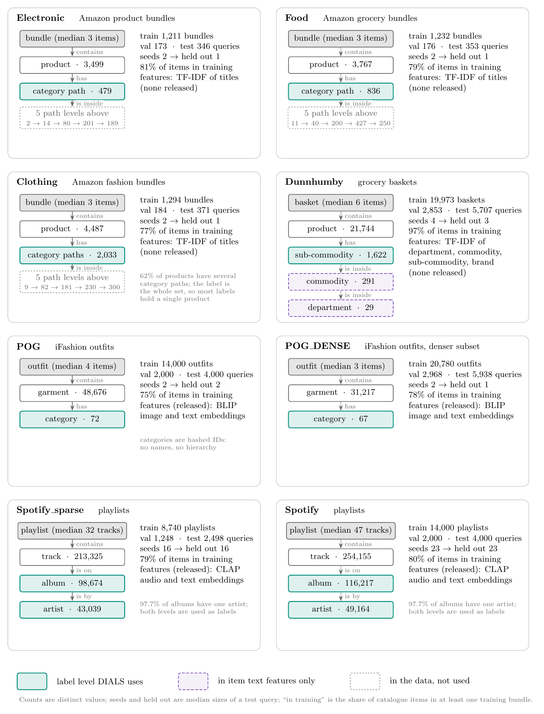
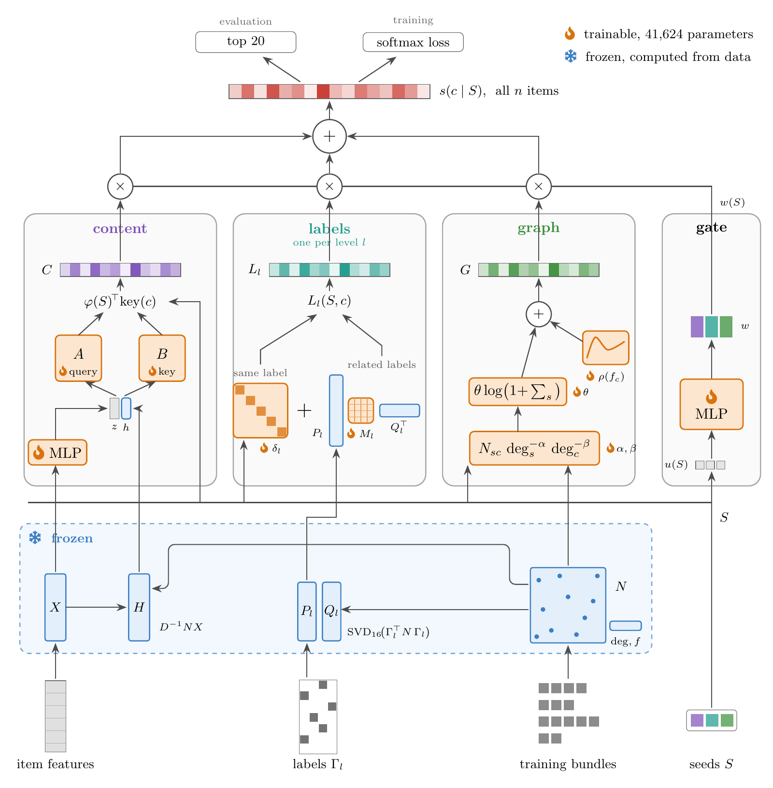
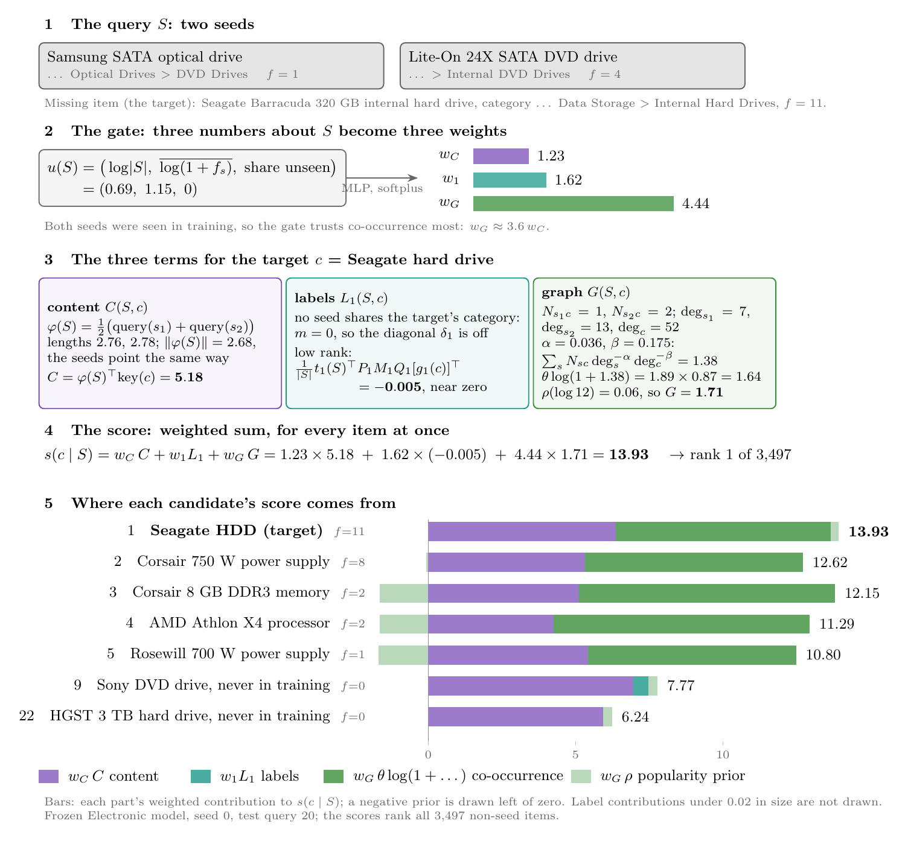

# How DIALS works

This document explains the model in this repository from first principles. It assumes linear algebra and basic
neural-network training, but no knowledge of the repository or of earlier versions of the model. Each section says
what a component computes, why it is there, and where it lives in the code.

1. [The task](#1-the-task)
2. [The data: how each dataset is organized](#2-the-data-how-each-dataset-is-organized)
3. [The architecture at a glance](#3-the-architecture-at-a-glance)
4. [Notation and the matrices everything is built from](#4-notation-and-the-matrices-everything-is-built-from)
5. [The score in one line](#5-the-score-in-one-line)
6. [Term 1: content](#6-term-1-content)
7. [Term 2: labels (diagonal plus low rank)](#7-term-2-labels-diagonal-plus-low-rank)
8. [Term 3: co-occurrence graph](#8-term-3-co-occurrence-graph)
9. [The gate](#9-the-gate)
10. [Training](#10-training)
11. [Keeping training free of leakage](#11-keeping-training-free-of-leakage)
12. [Evaluation](#12-evaluation)
13. [Parameters and cost](#13-parameters-and-cost)
14. [What the trained models learn](#14-what-the-trained-models-learn)
15. [Design decisions and the evidence for them](#15-design-decisions-and-the-evidence-for-them)
16. [Code map](#16-code-map)

---

## 1. The task

A **bundle** is a set of items that belong together: an outfit, a playlist, a product set. In **bundle completion**
we see part of a bundle, the **seeds** $S$, and must rank every item in the catalogue so that the missing members come
first. Quality is measured by Recall@20 and NDCG@20 over the top 20 of the whole catalogue (section 12).

The model sees four kinds of information:

| Source | What it is | Example |
|---|---|---|
| Training bundles | lists of item IDs | 20,780 outfits on POG_DENSE |
| Item features | one vector per item | the released features only: BLIP image and text embeddings (POG), CLAP audio and text embeddings (Spotify), both from the CLHE release; where nothing is released, TF-IDF of the item text (e-commerce, Dunnhumby) |
| Item labels | one or more categorical attributes per item | category (POG, e-commerce); artist and album (Spotify) |
| Training frequency | how many training bundles contain the item | derived from the bundles |

There are no user IDs and no test information. Everything the model knows about which items go together comes from
the training bundles.

## 2. The data: how each dataset is organized

Every dataset has the same three layers: a **bundle** contains **items**, and each item carries **labels**. The
datasets differ in what those layers are, how many label levels exist, and which of them DIALS uses.

<p align="center"></p>

Read each panel top-down: a bundle contains items, and each item has a label value at every label level. Teal boxes
are the label levels DIALS uses (section 7). Purple dashed boxes enter only through the item's text features. Grey
dotted boxes exist in the raw data but are not used.

| Dataset | Bundle | Item | Label levels used | Split |
|---|---|---|---|---|
| Electronic, Food, Clothing | product bundle | product | 1: the category path, as one label | our seeded 70/10/20 split |
| Dunnhumby | grocery basket | product | 1: sub-commodity | our seeded 70/10/20 split |
| POG, POG_DENSE | outfit | garment | 1: category | the released split files |
| Spotify_sparse, Spotify | playlist | track | 2: artist and album | the released split files |

Four features of the data shape how the model behaves:

- **The e-commerce categories are paths in a taxonomy** (Electronics › Computers & Accessories › … › Cases &
  Sleeves). DIALS treats the whole path as one label value, so the coarser levels are not used. On Clothing, 62% of
  products have several paths, and the label is the whole set: 2,033 label values for 4,487 products. So most labels
  hold a single product, and the "same label" part of the label term rarely fires there.
- **POG's categories are hashed IDs:** 72 values, with no names and no hierarchy. Most POG targets come from a category
  that none of the seeds has (an outfit needs shoes as well as a dress), so the label-to-label part matters most here.
- **Spotify has two nested levels.** 97.7% of albums have a single artist, so the album is almost a refinement of the
  artist. Both are used, each as its own label level with its own parameters.
- **Dunnhumby has a three-level hierarchy** (department › commodity › sub-commodity). Only the finest level is a label;
  the two coarser ones appear only as words in the item features.

The split also differs. POG and Spotify use the split files released with the data, so their numbers are directly
comparable with published results. The e-commerce sets and Dunnhumby have no released split, so the loaders make a
seeded one (`dials/data.py`). Query sizes follow the bundles: a typical POG query gives 2 seeds and hides 2, and a
Spotify query gives 23 tracks and hides 23.

## 3. The architecture at a glance

<p align="center"></p>

Read the figure from the bottom up:

1. **Inputs.**
2. **❄️ Frozen layer.** It is computed once from the training split, and nothing in it is trained.
3. **Three score towers.**
   - Content $C$: do the candidate's features and partners look like the seeds'?
   - Labels $L_l$, one per label level: a learned "same label" score plus a learned label-to-label relation built on
     fixed spectral factors of the label co-occurrence.
   - Graph $G$: how often the candidate was bought with the seeds, discounted by popularity, plus a popularity prior.
4. **Gate.** It weights the towers per query.
5. **Weighted sum.** It gives a score for every item in the catalogue.

🔥 marks the 41,624 trained parameters. During training, a bundle's own contribution is removed from the
co-occurrence statistics before it is scored, and the spectral label factors it sees are computed without it
(section 11). Sections 4 to 9 define every symbol in the figure. The figure's source is `figures/architecture.tex`.

## 4. Notation and the matrices everything is built from

| Symbol | Shape | Meaning |
|---|---|---|
| $n$ | | number of items in the catalogue |
| $d = 128$ | | feature dimension |
| $X$ | $n \times d$ | item features, each row L2-normalized (`features`) ❄️ |
| $N$ | $n \times n$, sparse | co-occurrence counts: $N_{sc}$ = number of training bundles containing both $s$ and $c$, $s \ne c$ ❄️ |
| $\deg_c = \sum_s N_{sc}$ | $n$ | co-occurrence degree of item $c$ (`history_mass`) ❄️ |
| $f_c$ | $n$ | training frequency: number of training bundles containing $c$ (`frequency`) ❄️ |
| $l$ | | a label **level**: a kind of label. POG has one (category); Spotify has two (artist, album) |
| $g$ | | one label **value** within a level, such as the category "dresses" or one artist |
| $K_l$ | | number of distinct label values at level $l$ (72 categories on POG; 49,164 artists on Spotify) |
| $g_l(c)$ | | a lookup: the label value of item $c$ at level $l$ |
| $\Gamma_l$ | $n \times K_l$ | one-hot incidence: $(\Gamma_l)_{cg} = 1$ if $g_l(c) = g$ ❄️ |
| $S$ | | the seed set of one query; $\lvert S \rvert$ its size |

$N$ is the only object built from bundles. Everything collaborative in the model is a function of $N$, $\deg$ and
$f$. `model.pair_counts` builds $N$ as sorted (source, target, count) triples plus a CSR-style pointer, so the
partners of any item are one contiguous slice.

Two derived quantities are used repeatedly.

**Partner history.** For each item, the co-occurrence-weighted mean feature of its partners:

```math
H = D^{-1} N X, \qquad D = \operatorname{diag}(\deg) \qquad (n \times d;\ \text{a row is zero when } \deg = 0)
```

An item that is rarely seen has an uninformative own feature, but if it was bought with known items, $H$ says what
those were. In the code: `history_sum` $= NX$, `history()`.

**Label co-occurrence** at level $l$, how often label value $g$ appears in a bundle with label value $g'$. It is $N$
summed up to label values:

```math
\bar N_l = \Gamma_l^\top N \,\Gamma_l \qquad (K_l \times K_l)
```

Section 7 builds two fixed matrices from it, the spectral label factors $P_l$ and $Q_l$ ($K_l \times 16$ each).

**Trained parameters** are introduced with the term they belong to: the maps $A_z, A_h, B_z, B_h$ and the encoder MLP
(section 6), $\delta_l$ and $M_l$ (section 7), $\theta$, $\alpha$, $\beta$ and $\rho$ (section 8), and the gate MLP
(section 9). Section 13 lists them all with their sizes.

## 5. The score in one line

For a query with seeds $S$, every catalogue item $c$ gets

```math
s(c \mid S) \;=\; w_C(S)\, C(S,c) \;+\; \sum_l w_l(S)\, L_l(S,c) \;+\; w_G(S)\, G(S,c)
```

It's a weighted sum of three kinds of evidence:

- **$C$ (content):** do $c$'s features and partners look like the seeds'?
- **$L_l$ (labels):** is $c$'s category, artist or album compatible with the seeds' labels?
- **$G$ (graph):** was $c$ bought together with the seeds, and how popular is it?

The weights $w(S) \ge 0$ come from a small **gate** that looks only at simple statistics of $S$ (section 9). All
scores for all $n$ items are computed at once as a row vector per query. A batch of $q$ queries gives a $q \times n$
matrix (`DIALS.forward`).

### The running example

One real query is followed through the rest of this document, with the numbers the trained model produces: Electronic
test query 20, scored by the frozen seed-0 model. The seeds are $S = \{s_1, s_2\}$, a Samsung SATA optical drive
($f_{s_1} = 1$) and a Lite-On SATA DVD drive ($f_{s_2} = 4$). The missing item, the target $c$, is a Seagate 320 GB
internal hard drive ($f_c = 11$). Electronic has one label level, the category path, so $l$ takes the single value 1.

<p align="center"></p>

The figure's panels use symbols that sections 6 to 9 define; panel 5 can be read now. Those sections compute each
piece for the target: content $C(S,c) = 5.18$, labels $L_1(S,c) = -0.005$, graph
$G(S,c) = 1.71$, and gate weights $w_C = 1.23$, $w_1 = 1.62$, $w_G = 4.44$. The score is their weighted sum:

```math
s(c \mid S) = w_C\, C + w_1 L_1 + w_G\, G = 1.23 \times 5.18 + 1.62 \times (-0.005) + 4.44 \times 1.71 = 13.93
```

That is the highest of the 3,497 items that are not seeds, so the target is ranked first. Panel 5 of the figure splits
the scores of seven candidates into their weighted parts:

- **Ranks 1 to 5** are all computer parts bought with these drives: a hard drive, two power supplies, memory and a
  processor. Co-occurrence (dark green) is the largest part for all of them, and content (purple) separates them.
- **Two items never seen in training** have no co-occurrence, so content and labels must carry them. A Sony DVD
  drive has the highest content score of all seven, yet ranks 9th. An HGST hard drive in the target's own category
  ranks 22nd. This is the model's main weakness: on POG, 59% of held-out test items never occur in a training bundle,
  and DIALS puts 3.3% of them in its top 20.

The parts were extracted from the frozen model and add up to its scores to within $10^{-4}$.

## 6. Term 1: content

**What it computes.** First, the features are refined by a small residual MLP 🔥 and renormalized:

```math
Z = \operatorname{normalize}\big(X + \mathrm{MLP}(X)\big), \qquad \mathrm{MLP}: \mathbb{R}^{128} \to \mathbb{R}^{32} \to \mathbb{R}^{128}
```

The last layer of the MLP is initialized to zero, so $Z = X$ at the start.

Each item then gets a query vector (used when it is a seed) and a key vector (used when it is a candidate), both
rank-64 maps of its own features $z$ and its partner history $h$ (rows of $Z$ and $H$):

```math
\mathrm{query}(s) = A_z z_s + A_h h_s, \qquad \mathrm{key}(c) = B_z z_c + B_h h_c, \qquad A_z, A_h, B_z, B_h \in \mathbb{R}^{64 \times 128}
```

The four maps $A_z, A_h, B_z, B_h$ are trained 🔥.

The seeds' query vectors are averaged, and the content score is an inner product:

```math
\varphi(S) = \frac{1}{\lvert S \rvert} \sum_{s \in S} \mathrm{query}(s), \qquad C(S,c) = \varphi(S)^\top \mathrm{key}(c)
```

For all candidates at once this is one matrix product, $\varphi(S)^\top \big(Z B_z^\top + H B_h^\top\big)^\top$.
The $n \times 64$ key matrix is computed once per evaluation pass and reused, together with $Z$, $H$ and the
prior (`cache()`).

**In the example.** The two seeds' query vectors have lengths 2.76 and 2.78. Their mean $\varphi(S)$ has length 2.68,
almost as long as either, so the two DVD drives point in nearly the same direction. The target's key has length 2.42,
and the content score is one inner product:

```math
C(S,c) = \varphi(S)^\top \mathrm{key}(c) = 5.18
```

The Sony DVD drive scores higher, $C = 5.66$. It is a third DVD drive, so it looks like the seeds; the hard drive is
what completes them. Ranked by content alone, the Sony drive would be 2nd and the target only 27th; the other terms
are what move the target to first.

**Why this form.**
- **Two maps instead of one similarity (asymmetric).** "Items that complete $s$" is not "items similar to $s$": a
  shirt needs trousers, not more shirts. Separate query and key maps can learn that.
- **Partner history.** It lets an item's collaborative context enter through a fixed $d$-dimensional summary, with
  no per-item embedding table.
- **Initialization.** $A_z = B_z = \sqrt{10}\,[I_{64}\ 0]$ and $A_h = B_h = 0$, so the model starts as 10 × the dot
  product of the first 64 feature coordinates (seed mean against candidate) and learns away from it.

## 7. Term 2: labels (diagonal plus low rank)

There is one label term per label **level** $l$, each with its own parameters: one level on Electronic and POG
(the category), two on Spotify (artist and album). Within a level, $g$ ranges over the label **values**, and $g_l(c)$
is the value item $c$ has. The term needs three numbers per query and candidate. In the running example ($l = 1$),
two candidates show both cases:

| Symbol | Meaning | Target: Seagate hard drive | Sony DVD drive |
|---|---|---|---|
| $t_l(S) \in \mathbb{R}^{K_l}$ | how many seeds carry each label value: $t_l(S)_g = \#\{s \in S : g_l(s) = g\}$ | 1 at "… › DVD Drives", 1 at "… › Internal DVD Drives", 0 at the other 477 categories (the same for every candidate) | the same |
| $m = t_l(S)_{g_l(c)}$ | how many seeds share the candidate's label value | 0: "… › Internal Hard Drives" is no seed's category | 1: the Samsung seed's category |
| $n_{g_l(c)}$ | how many catalogue items carry that label value | 32 | 8 |

The label score has two parts. The **diagonal part** asks whether $c$ shares a seed's label value. The **low-rank
part** asks which label values go with which, so it can also score a candidate whose label no seed has.

**The diagonal part 🔥.** A tiny MLP $\delta_l$ ($3 \to 16 \to 1$) scores a shared label value. It fires only when
$m > 0$:

```math
\mathrm{diag}_l(S,c) = \delta_l\big(\log(1+m),\ \log\lvert S\rvert,\ \log(1+n_{g_l(c)})\big)\,\mathbf{1}[m>0]
```

Its output can be positive or negative, so the model decides from data whether a shared label is good (same artist
on a playlist) or bad (a second pair of shoes in an outfit). Its inputs let that depend on how many seeds share the
label, on the query size, and on how common the label is.

**The low-rank part.** A full $K_l \times K_l$ table of label-to-label affinities would have, for example,
$43{,}039^2$ entries for the Spotify_sparse artists, and would memorize rare labels. Instead the model uses a fixed
spectral basis ❄️. Normalize the label co-occurrence $\bar N_l$ (section 4) by the label degrees
$D_l = \operatorname{diag}(\bar N_l \mathbf{1})$ and take its rank-16 SVD:

```math
\hat N_l = D_l^{-1/2}\, \bar N_l\, D_l^{-1/2} \;\approx\; U \Sigma V^\top, \qquad P_l = U \Sigma^{1/2}, \quad Q_l = V \Sigma^{1/2} \qquad (K_l \times 16)
```

Row $g$ of $P_l$, written $P_l[g]$, is a 16-number description of label value $g$, and so is $Q_l[g]$. Their
products reproduce the observed affinity, $P_l Q_l^\top \approx \hat N_l$. $P_l$ and $Q_l$ are not trained; they
are part of the data, like $N$ (`model.label_factors`).

The model learns only a $16 \times 16$ matrix $M_l$ 🔥, initialized to zero, that reweights and mixes the 16
directions. The learned affinity between two label values, and the low-rank part of the score, are

```math
\mathrm{affinity}_l(g, g') = P_l[g]\, M_l\, Q_l[g']^\top, \qquad
\mathrm{low}_l(S,c) = \frac{1}{\lvert S\rvert}\sum_{g} t_l(S)_g\ \mathrm{affinity}_l\big(g,\, g_l(c)\big) = \frac{1}{\lvert S\rvert}\, t_l(S)^\top P_l M_l\, Q_l[g_l(c)]^\top
```

that is, the affinity of $c$'s label value to each seed's label value, averaged over the seeds. This costs 256
parameters per level however many labels exist, and labels that never co-occur in training can still get an
affinity through the shared directions.

**The label score** is the sum of the two parts:

```math
L_l(S,c) \;=\; \underbrace{\delta_l\big(\log(1+m),\ \log\lvert S\rvert,\ \log(1+n_{g_l(c)})\big)\,\mathbf{1}[m>0]}_{\text{diagonal: does } c \text{ share a seed's label?}}
\;+\; \underbrace{\frac{1}{\lvert S\rvert}\, t_l(S)^\top P_l M_l\, Q_l[g_l(c)]^\top}_{\text{low rank: which labels go with which?}}
```

**In the example.** For the Sony drive, $m = 1$, so the diagonal fires: $\delta_1(\log 2,\ \log 2,\ \log 9) = +0.32$,
a bonus for sharing a seed's category. For the target, $m = 0$, so the diagonal is off and only the low-rank part is
left. It reads the seeds' category mix, half each DVD category, and scores how well "Internal Hard Drives" goes with
it:

```math
L_1(S,c) = \frac{1}{\lvert S\rvert}\, t_1(S)^\top P_1 M_1\, Q_1[g_1(c)]^\top = -0.005
```

That is close to zero, and typical outside POG. Switching $M_l$ off in the trained models changes validation NDCG@20
by at most .0013 on six of the eight datasets, against .0067 on POG and .0053 on POG_DENSE (code review, 2026-11-10).
So the affinity between labels that never co-occur helps in practice on POG and POG_DENSE only.

**Diagonal plus low rank.** $\delta_l$ handles "same label" and $M_l$ handles "related labels". The name DIALS comes
from this split, and from the spectral factors being cross-fitted (section 11).

## 8. Term 3: co-occurrence graph

The most direct evidence is how often $c$ was bought with the seeds. Raw counts favour popular items, so each count
is discounted by both endpoints' degrees with learned exponents, summed over the seeds, and damped:

```math
G(S,c) \;=\; \theta \,\log\!\Big(1 + \sum_{s\in S} N_{sc}\, \deg_s^{-\alpha}\, \deg_c^{-\beta}\Big) \;+\; \rho\big(\log(1+f_c)\big)
```

- **$\alpha$ and $\beta$** 🔥 (initialized to 0, which gives raw counts) learn how much to discount popular seeds
  and popular candidates. $\alpha = \beta = \tfrac12$ would be the symmetric normalization $D^{-1/2} N D^{-1/2}$
  used by many graph filters; the model picks its own.
- **$\log(1+\cdot)$** stops one very frequent pair from dominating the whole score.
- **$\rho$** 🔥 is a small MLP ($1 \to 16 \to 1$) of the candidate's training frequency, a learned popularity prior.
  It can be non-monotone, for example to penalize items seen once.
- **$\theta$** 🔥 scales the term.

Computing it touches only the observed partners of the seeds: the cost is $\sum_{s\in S}\deg_s$ nonzeros, not $n$
(`graph_scores`, `expand`).

**In the example.** The target was bought with the first seed once and with the second twice: $N_{s_1c} = 1$ and
$N_{s_2c} = 2$. The degrees are $\deg_{s_1} = 7$, $\deg_{s_2} = 13$ and $\deg_c = 52$. The trained model has
$\alpha = 0.036$, $\beta = 0.175$ and $\theta = 1.89$:

```math
\sum_{s\in S} N_{sc}\,\deg_s^{-\alpha}\deg_c^{-\beta} = 1\cdot 7^{-0.036}\cdot 52^{-0.175} + 2\cdot 13^{-0.036}\cdot 52^{-0.175} = 0.467 + 0.914 = 1.38
```

```math
G(S,c) = \theta\log(1 + 1.38) + \rho\big(\log(1 + 11)\big) = 1.89 \times 0.87 + 0.06 = 1.64 + 0.06 = 1.71
```

The prior $\rho$ is not monotone in this model. Over the candidates in the figure it gives $+0.06$ at $f = 11$,
$-0.02$ at $f = 8$, $-0.37$ at $f = 2$, $-0.38$ at $f = 1$ and $+0.07$ at $f = 0$: items seen only once or twice are
pushed down. The Sony DVD drive and the HGST hard drive were never in a training bundle, so their sum is 0 and only
the prior is left.

## 9. The gate

How much to trust each term depends on the query. A query whose seeds were never seen in training has no graph
evidence, and a large query has more reliable label statistics. The gate maps three numbers about $S$ through a
small MLP 🔥 ($3 \to 16 \to 2 + \text{number of label levels}$) and a softplus:

```math
u(S) = \Big(\log\lvert S\rvert,\ \ \frac{1}{\lvert S\rvert}\sum_{s\in S}\log(1+f_s),\ \ \frac{\#\{s\in S: f_s = 0\}}{\lvert S\rvert}\Big),
\qquad w(S) = \operatorname{softplus}\big(\mathrm{MLP}(u(S))\big) \ge 0
```

The output has one weight per term: $w_C$ for content, $w_l$ for each label level $l$, and $w_G$ for graph. That is
3 weights on the datasets with one label level ($w_C, w_1, w_G$) and 4 on Spotify, whose two levels are artist and
album ($w_C, w_1, w_2, w_G$). The last layer starts at zero weight with
bias $\log(e-1)$, so softplus $= 1$ and every term starts with weight 1.

**In the example.** The two seeds have $f = 1$ and $f = 4$, so

```math
u(S) = \Big(\log 2,\ \tfrac12\big(\log 2 + \log 5\big),\ 0\Big) = (0.69,\ 1.15,\ 0)
```

and the gate returns $w_C = 1.23$, $w_1 = 1.62$, $w_G = 4.44$. Both seeds were seen in training (the third statistic
is 0), so co-occurrence gets the largest weight, 3.6 times that of content. The weights depend only on $S$, so every
candidate is scored with these same three numbers.

## 10. Training

**Examples.** Each step takes 32 training bundles. For each bundle $b$, its items are shuffled and split into
visible seeds $S$ and hidden targets $T$. With probability ½ the cut is at the middle, otherwise at a uniformly
random point, with at least one item on each side (`train.hide`). Varying the cut trains the model for queries of
every size.

**Loss.** Every catalogue item outside the bundle is a negative. For a hidden item $j$:

```math
\mathrm{LSE} = \log \sum_{c \notin b} e^{\,s(c\mid S)}, \qquad
\ell = \frac{1}{\lvert T\rvert}\sum_{j\in T} \operatorname{softplus}\big(\mathrm{LSE} - s(j\mid S)\big)
= -\frac{1}{\lvert T\rvert}\sum_{j\in T}\log\sigma\big(s(j\mid S) - \mathrm{LSE}\big)
```

This is a full-catalogue softmax with no negative sampling. Seeds and the other hidden items are excluded from the
negatives, because they are positives too (`train.loss`).

**Optimization.** AdamW with two groups: learning rate $10^{-2}$ for the small relation parameters ($M_l$,
$\delta_l$, $\alpha$, $\beta$, $\theta$, $\rho$, gate) and $10^{-3}$ for the content maps and encoder. Weight decay
is $10^{-3}$ for both, and gradients are clipped to norm 5.

**Model selection.** After every epoch, NDCG@20 is measured on the validation queries. The best epoch is kept, and
training stops after 6 epochs without improvement or at 100 epochs.

**Determinism.** Fixed seeds, `torch.use_deterministic_algorithms(True)` and single-threaded BLAS (set when `dials`
is imported) make a run bit-reproducible. Interrupted runs resume from `last.pt`.

All settings live in `train.CONFIG`; nothing is tuned per dataset.

## 11. Keeping training free of leakage

During training, the bundle $b$ being scored is itself part of $N$, $\deg$, $f$ and $H$. Without care, the model
would be rewarded for reading the answer: $c$ was bought with the seeds because of this very bundle. At test time the
query's bundle is not in the training data, so what the model learned this way would not transfer. Two mechanisms
prevent it.

**Leave-one-out (exact).** When $b$ is scored, its own contribution is subtracted from everything it touched:

| Quantity | Training value for bundle $b$ |
|---|---|
| counts | $N_{sc} - 1$ for $s, c$ both in $b$ |
| degrees | $\deg_s - (\lvert b\rvert - 1)$ for $s \in b$; the same for candidates $c \in b$ |
| frequency | $f_c - 1$ for $c \in b$ (popularity prior and gate) |
| partner history | $h_s$ recomputed without $b$'s partners, for seeds and for $b$'s members as candidates |

These are cheap corrections on the touched rows, not a rebuild of $N$ (`loo_history`, the `bundles is not None`
branches in `graph_scores` and `content_scores`).

**Cross-fitting (for the label SVD).** $P_l$ and $Q_l$ come from an SVD of the label co-occurrence $\bar N_l$, which is
built from all of $N$. Subtracting one bundle from $N$ would change the SVD, which cannot be corrected cheaply. So the training bundles are split into five folds:
- a bundle's fold is a hash of its sorted item set, so identical bundles share a fold (`model.fold_of`);
- five extra pairs $\big(P_l^{(k)}, Q_l^{(k)}\big)$ are computed from the bundles outside fold $k$;
- a training bundle in fold $k$ is scored with $\big(P_l^{(k)}, Q_l^{(k)}\big)$, which never saw it;
- at evaluation, the factors from all training bundles are used (`cross_fitted_labels`).

This is the same idea as cross-fitting in statistics: a feature used to fit a sample is never estimated from that
sample.

## 12. Evaluation

For each test query, the model scores the whole catalogue. Seeds are removed, and the top 20 are taken; exact ties
go to the lower item ID, so results do not depend on batching (`evaluate.top_items`). With $T$ the hidden items and
$\mathrm{hit}_k = 1$ if the $k$-th ranked item is in $T$:

```math
\mathrm{Recall@20} = \frac{1}{\lvert T\rvert}\sum_{k=1}^{20}\mathrm{hit}_k, \qquad
\mathrm{NDCG@20} = \frac{\sum_{k=1}^{20} \mathrm{hit}_k / \log_2(k+1)}{\sum_{k=1}^{\min(\lvert T\rvert,\,20)} 1/\log_2(k+1)}
```

The metrics are averaged over queries and then over seeds 0, 1 and 2.

- **Clean test queries.** In the supplied POG and Spotify splits, a few test bundles also occur, complete, in
  training or validation. Results are reported on the queries without such overlap; `Dataset.clean_test` lists them.
- **E-commerce data.** The Electronic, Food and Clothing splits are made by `data.load_resplit`, which removes
  duplicate bundles first, so every test query is clean.

## 13. Parameters and cost

With $d = 128$, rank 64, hidden 32 and label rank 16, the parameter count is the same on every dataset:

| Component | | Shape | Parameters |
|---|---|---|---:|
| Content maps $A_z, B_z, A_h, B_h$ | 🔥 | $4 \times (64 \times 128)$ | 32,768 |
| Feature encoder | 🔥 | $128 \to 32 \to 128$ | 8,352 |
| Label mixing $M_l$ | 🔥 | $16 \times 16$ per level | 256 per level |
| Label diagonal $\delta_l$ | 🔥 | $3 \to 16 \to 1$ per level | 81 per level |
| Degree exponents $\alpha, \beta$ and scale $\theta$ | 🔥 | | 3 |
| Popularity prior $\rho$ | 🔥 | $1 \to 16 \to 1$ | 49 |
| Gate | 🔥 | $3 \to 16 \to (2 + \text{number of label levels})$ | 115 (one level) or 132 (two) |
| **Total trainable** | | | **41,624** (one level) / **41,978** (Spotify: artist and album) |
| $X$, $N$, $\deg$, $f$, $H$, $P_l$, $Q_l$ and fold copies | ❄️ | grow with the catalogue | not trained; rebuilt from the data, not stored in checkpoints |

There are no per-item or per-label embeddings, so the trainable part does not grow with the catalogue. A
254,000-item catalogue uses the same 41,978 parameters as a 3,500-item one. Only the frozen data grows.

**Costs:**

| Cost | What it involves | Measured |
|---|---|---|
| Setup, once | pair counts ($\sum_b \lvert b\rvert^2$ over training bundles), then 6 rank-16 label SVDs per level (all bundles plus 5 folds) on $K_l \times L_l$ matrices; label factors cached in `cache/` | |
| Inference, per query | graph $\sum_{s\in S}\deg_s$, content one $64 \times n$ product, labels $16 \times n$ per level | 0.1 ms per query on e-commerce, 0.5–0.6 ms on POG, 3–4 ms on Spotify (4 CPU threads, test pass ÷ queries) |
| Training, one seed | | seconds on e-commerce, about an hour on POG, a few hours on Spotify (one thread) |

## 14. What the trained models learn

The values below are averaged over the three seeds; the gate weights are averaged over the first 512 validation
queries. $\delta$ is evaluated at a label of median size.

| Dataset | $\theta$ | $\alpha$ | $\beta$ | Gate weight: content / labels / graph | $\delta$ for one of 3 seeds sharing $c$'s label |
|---|---:|---:|---:|---|---|
| Electronic | 1.94 | .05 | .15 | 1.33 / 2.16 / 5.05 | +0.73 (category) |
| Food | 1.77 | .01 | .05 | 1.21 / 1.05 / 4.70 | +1.63 |
| Clothing | 1.77 | .04 | −.15 | 1.88 / 1.60 / 6.57 | +1.91 |
| POG_DENSE | 4.58 | .41 | .37 | 5.99 / 15.24 / 3.14 | **−0.31** |
| POG | 2.38 | .31 | .31 | 4.18 / 14.78 / 3.73 | **−0.16** |
| Spotify_sparse | 0.83 | −.07 | −.05 | 3.05 / 1.24, 1.28 / 0.82 | +2.82 (artist), +1.43 (album) |
| Spotify | 1.10 | .33 | −.30 | 3.07 / 1.01, 1.14 / 1.10 | +2.63 (artist), +1.17 (album) |

- **On POG outfits, a shared category is penalized,** and the label term has the largest gate weight. An outfit
  needs one item per category, so "same category as a seed" is evidence against. Nothing in the model says this; the
  sign of $\delta$ is learned.
- **On playlists, a shared artist or album is rewarded.** On the e-commerce sets a shared category is rewarded too:
  their bundles group related products.
- **The degree exponents differ by domain.** POG learns to discount popular items on both sides
  ($\alpha, \beta \approx .3$–$.4$). Spotify discounts popular seeds but slightly favours popular candidates
  ($\beta < 0$). The e-commerce sets keep nearly raw counts.

## 15. Design decisions and the evidence for them

**One fixed configuration.** A single configuration was used on all seven datasets, with no per-dataset tuning. The
e-commerce datasets were never used while the model was developed.

**No second graph hop.** An earlier version added a second hop, $\theta_2 \log\big(1 + [a A']_c\big)$, where $a$ is
the vector of discounted first-hop weights and $A'$ a degree-discounted $N$ approximated by a cross-fitted rank-64
SVD. It was meant to reach partners of partners. Retrained without it (three seeds, Holm over 14 tests), test
NDCG@20 was:
- level on Electronic, Food, Clothing, POG_DENSE and Spotify_sparse;
- slightly better without it on POG (+.0007);
- .005 lower without it on full Spotify (.2865 → .2816, significant; these runs used the earlier item features, RESULTS.md section 6).

Removing it drops six rank-64 SVDs of the $n \times n$ graph (about 2.5 minutes and 0.8 GB on Spotify), made POG
inference about 3× faster in our timings, and leaves one graph term to explain. It was removed on that trade-off,
accepting the Spotify cost.

**Spectral label factors instead of free label embeddings.** An earlier version learned $P$ and $Q$ freely. It
memorized the bundles of rare labels. Fixing $P$ and $Q$ to the SVD of the observed label co-occurrence, and
learning only $M$, removed that and cut the label parameters to 256 per level.

**Leave-one-out without random history masking.** An earlier version also hid a random 25% of item histories during
training. Leave-one-out alone was compared with leave-one-out plus that masking on validation, and was kept.

**Full-catalogue loss.** Every non-member is a negative, so there is no sampling distribution to tune and no
mismatch between training and full-catalogue evaluation.

## 16. Code map

    dials/
      __init__.py    pins BLAS to one thread before numpy loads (bit-reproducible SVDs)
      data.py        Dataset; load(name): splits, features (X), labels (Γ), clean test queries
                     load_supplied: POG / Spotify supplied splits; projected_features: released modalities → 128 dims
                     load_resplit:  Electronic / Food / Clothing: deduplicate, 70/10/20 split, hide half
      model.py       pair_counts (N, deg, f); fold_of, label_factors, cross_fitted_labels (P_l, Q_l and fold copies)
                     DIALS: content_scores (§6), label_scores (§7), graph_scores (§8), gate_weights (§9), forward (§5)
      train.py       CONFIG; spectral (cached label factors); build / load; hide, loss, fit (§10)
      evaluate.py    top_items, query_metrics, evaluate, subset (§12)
      __main__.py    python -m dials train | test

Data flow for one training run:

1. `data.load` reads the splits, the features $X$, the labels and the clean test queries.
2. ❄️ `train.spectral` computes $P_l, Q_l$ from all training bundles plus one pair per fold, and caches them in `cache/`.
3. ❄️ `DIALS(...)` builds $N$, $\deg$, $f$ and $H$ from the training bundles; 🔥 the parameters are initialized.
4. 🔥 Each epoch `train.fit` runs batches of 32 bundles through hide → leave-one-out forward → loss → AdamW, then
   evaluates validation NDCG@20 and keeps the best epoch.
5. The run is saved to `runs/<dataset>/seed<s>/`, and `python -m dials test` scores the test queries.
