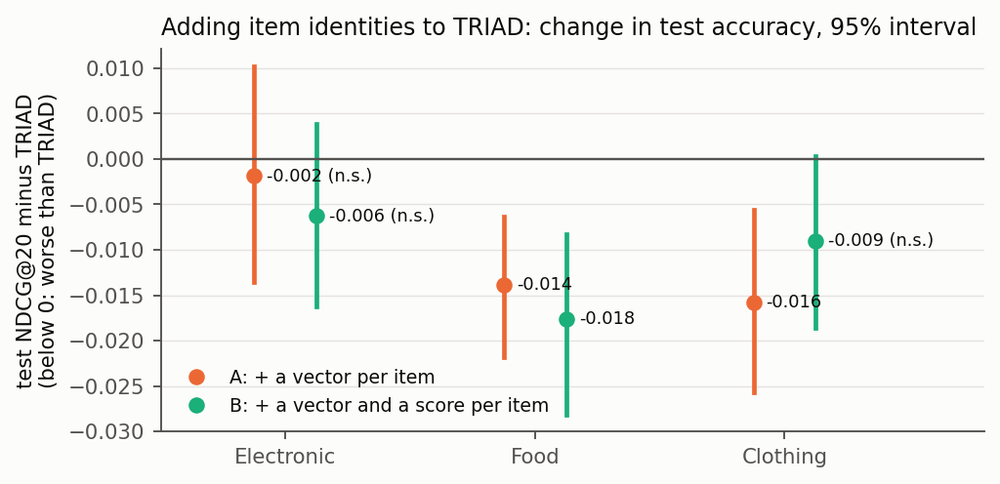
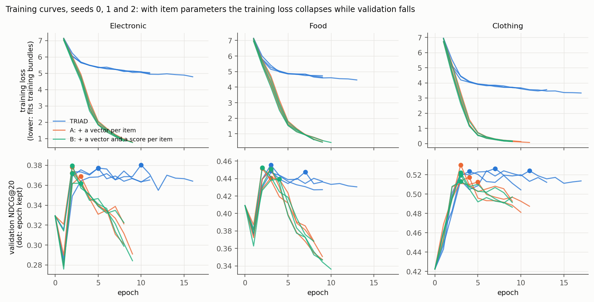

# Does TRIAD need item identities? The item-identity test

The paper's principle is that bundle completion rests on **relations between items**, not on **knowing each item**.
This document explains, one step at a time, the experiment that tests this directly: give TRIAD per-item parameters
and see what happens.

- Code: `analysis/item_identity.py`
- Results: `results/item_identity.json`, and the runs in `runs/item_identity/`
- Figures: `figures/explained/identity_results.png` and `identity_curves.png`, drawn by
  `python -m analysis.explained_figures` from these files

---

## Step 1. What "item identity" means

There are two ways to describe an item to a model.

- **By what it is:** its features (an embedding of its title, image or audio), its labels (category, artist, album),
  and its history (how often it was bundled, and with what). Two items with the same description are treated the
  same. This is all TRIAD uses. No TRIAD parameter belongs to one item.
- **By who it is:** a learned row of numbers for each item, looked up by the item's ID. This is an **ID embedding**.
  The row for item $c$ is learned only from the training bundles that contain $c$. CLHE and RaMen use such rows, and
  most of their parameters are in these tables.

## Step 2. The question, and what each answer would mean

**Question:** if we give TRIAD an ID embedding for every item, does it get better?

Think through the possible outcomes before looking at the result:

- **If the item-level knowledge is useful,** the model should get better. Adding the rows cannot remove anything
  TRIAD already has: they start at zero (Step 3), so the model can always leave them near zero. Validation can also
  keep the model from any epoch, so a harmful row would have to be learned before it could do damage.
- **If the signal is in the relations** and the rows add nothing that generalises, the model should not get better.
  It may even get worse, because the rows can fit the training bundles in ways that do not carry over to new bundles.

So the test can support or contradict the principle. It was not set up to come out one way.

## Step 3. How the item parameters are added

Two variants, each a copy of the final TRIAD with item parameters added.

**Variant A: a vector per item.** Every catalogue item $c$ gets a learned vector $e_c$ of 128 numbers, the same size
as its features. It is added inside the content part, where TRIAD refines the item features:

```math
z_c=\mathrm{normalize}\big(x_c+\mathrm{MLP}(x_c)+e_c\big).
```

Here $x_c$ is the item's input feature vector and $\mathrm{MLP}(x_c)$ is TRIAD's shared refinement. Without $e_c$,
two items with the same features get the same $z$. With $e_c$, each item can move to its own place.

**Variant B: a vector and a score per item.** As A, plus one learned number $b_c$ per item, added to the item's final
score. This lets the model learn "item $c$ is a good answer" with no reason attached.

**Both start at zero.** $e_c=0$ and $b_c=0$ before training, so the untrained model is exactly TRIAD. The new
parameters are created after TRIAD's own, so TRIAD's random starting weights are also the same. This was checked: in
all 9 runs (3 datasets × 3 seeds) the untrained validation score equals TRIAD's.

**Size.** TRIAD has 74,136 parameters. Variant A adds 128 per item, so 522,008 (Electronic, 3,499 items) to 648,472
(Clothing, 4,487 items). Variant B adds one more per item: 525,507 to 652,959.

## Step 4. What is kept the same

Everything except the added parameters:

- the same datasets, splits, item features and labels;
- the same training loop: hide part of each training bundle, score the catalogue, softmax loss;
- the same leave-one-out rule: while a bundle is scored, it is removed from the co-occurrence counts;
- the same configuration: learning rates (halved on these three sets, as for TRIAD), weight decay, batch size and
  gradient clipping. $e_c$ learns at the content matrices' rate and $b_c$ at the small parameters' rate;
- the same model seeds 0, 1 and 2, and the same early stopping: after each epoch, validation NDCG@20 is computed, and
  the best epoch is kept (epoch 0, the untrained model, included).

## Step 5. How the comparison is made

- **Datasets:** Electronic, Food and Clothing.
- **Metric:** NDCG@20 on the clean test queries. Each model is averaged over its three seeds, per query.
- **Test:** for each dataset, variant minus TRIAD, paired over the same queries. The 95% interval comes from a
  bootstrap over queries and the p-value from a sign-flip test. Holm's correction is applied over the three datasets,
  separately for each variant.

## Step 6. Result: item identities never help



**How to read it.** Each dot is the variant's test NDCG@20 minus TRIAD's, and the line is its 95% interval. Below 0
means the variant is worse than TRIAD. "n.s." means not significant after Holm.

| Dataset | TRIAD | A: + vector per item | A minus TRIAD [95% interval], p | B: + vector and score | B minus TRIAD [95% interval], p |
|---|---|---|---|---|---|
| Electronic | .341 | .339 | −.002 [−.014, +.010], p .75 | .335 | −.006 [−.016, +.004], p .22 |
| Food | .488 | .474 | **−.014** [−.022, −.006], p .002 | .471 | **−.018** [−.028, −.008], p .002 |
| Clothing | .451 | .435 | **−.016** [−.026, −.006], p .002 | .442 | −.009 [−.019, +.000], p .10 |

- In all six comparisons the variant scores **below** TRIAD.
- Three are significant (Food with A and with B, Clothing with A). The other three are small and not significant.
- No comparison shows an improvement, and every interval stays at or below about +.01.

The validation score of the kept model is lower too: TRIAD .378, .451, .525; variant A .373, .448, .520; variant B
.371, .448, .518 (Electronic, Food, Clothing).

## Step 7. What happens during training



**How to read it.** Top row: the training loss after each epoch (lower means the model fits the training bundles
better). Bottom row: validation NDCG@20 after each epoch, with a dot at the epoch that was kept. One line per seed;
blue is TRIAD, orange variant A, aqua variant B.

**What it shows.**

1. **The training loss collapses with item parameters.** TRIAD's loss levels off: at its last epoch it is 4.8 to 5.0
   on Electronic, 4.5 to 4.7 on Food and 3.3 to 3.7 on Clothing. With item vectors it keeps falling, to 0.79 to 0.94,
   0.48 to 0.63 and 0.07 to 0.14 (variant A, last epoch). On Clothing the model fits the training bundles almost
   perfectly.
2. **At the same time, validation falls.** With item parameters, validation peaks at epoch 2 or 3, often about as high
   as TRIAD's best, and then drops steadily. On Food, for example, from .451 at epoch 2 to .368 at epoch 8 (variant A,
   seed 0). TRIAD's validation score stays roughly level for many epochs.
3. **So validation keeps an early epoch:** 2 to 5 with item parameters, against 3 to 11 for TRIAD. Even this early
   model is slightly worse than TRIAD on test (Step 6).

A training loss that keeps falling while validation falls is the usual sign of **memorisation**: the model learns the
training bundles themselves instead of what carries over to new bundles.

## Step 8. Why per-item parameters memorise and TRIAD's do not

This is the likely mechanism. It fits the curves in Step 7, but it was not measured separately.

- **Leave-one-out protects the counts, not learned parameters.** When a training bundle is scored, TRIAD removes that
  bundle from the co-occurrence counts, so the counts cannot reveal its hidden items. But the item vectors $e_c$ were
  trained on that same bundle in earlier steps. Each time the bundle is seen, the vectors of its items are pulled
  towards each other, so they come to store "these items were bundled together". Leave-one-out cannot remove what is
  already stored in the parameters.
- **TRIAD's parameters are shared by all items.** A content matrix, a label rule or a count exponent is used for every
  item and every bundle, so it cannot store which particular items were together. It can only learn rules that hold
  across many bundles, and those are what carry over to new bundles.
- **A row per item is learned from very few bundles.** On these datasets most items are in only a few training
  bundles, so each row has little data and fits it easily. An item in no training bundle gets a row that is never
  trained at all.

## Step 9. What the test shows, and what it does not

**It shows:**

- On these three datasets, adding item identities to TRIAD never improved test accuracy. It lowered it significantly
  in three of six comparisons.
- With item parameters, the training loss falls far below TRIAD's while validation falls. This is measured in the
  training logs, not assumed.
- This supports the principle: the useful signal is in relations shared across items, and per-item parameters mostly
  add a way to memorise training bundles.

**It does not show:**

- **Denser data.** Only the three e-commerce sets were tested, where items appear in few bundles. On data where items
  appear in many bundles, such as POG_DENSE, per-item parameters might help.
- **Better-regularised item vectors.** $e_c$ and $b_c$ used TRIAD's learning rates and weight decay. Stronger
  regularisation or a smaller vector might reduce the harm. It was not tuned separately.
- **Anything about CLHE or RaMen directly.** The test adds identities to TRIAD. It does not remove them from those
  models.

## Step 10. How to rerun it

```bash
PYTHONPATH=. python -m analysis.item_identity
PYTHONPATH=. python -m analysis.explained_figures
```

The first command trains the 18 runs (2 variants × 3 datasets × 3 seeds) and writes the results file. Finished runs
are reused. The second redraws the figures.

## A note on the paper's wording

The paper's contribution reads: "Giving TRIAD a learned vector per item lowers its test accuracy, and validation
picks earlier epochs, a sign of memorization." This fits the data, but a reader may take "lowers" to mean
"significantly, everywhere". A wording that matches Step 6 exactly: "Giving TRIAD a learned vector per item never
improves its test accuracy and lowers it significantly on two of three datasets; its training loss collapses while
validation falls, a sign of memorization."
