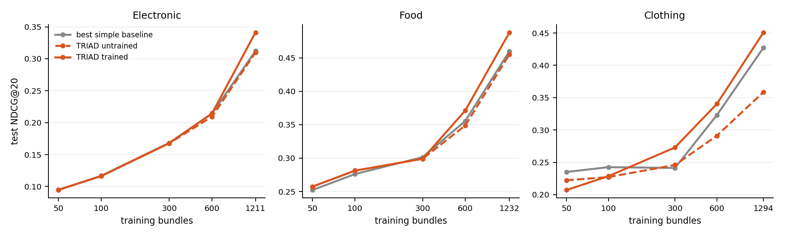

# Results

All numbers are for TRIAD as it is in this repository (ARCHITECTURE.md), seeds 0, 1 and 2.

- **Item features:** the released ones on POG (BLIP image and text) and Spotify (CLAP audio and text), the same files
  CLHE uses. On Electronic, Food and Clothing nothing is released, so the item titles are embedded with BLIP's text
  encoder (computed by us), and every method gets these vectors.
- **Metrics:** Recall@20 (R) and NDCG@20 (N), full-catalogue ranking with the seeds removed.
- **Clean queries:** on POG and Spotify, "clean" excludes test queries whose complete bundle also occurs in training
  or validation. The e-commerce splits have no such overlap, so all their queries are clean.
- **Statistics:** paired tests over queries, a cluster bootstrap for the interval and a sign-flip test for p
  (`triad/statistics.py`), Holm-corrected within each table.

## 1. TRIAD

| Dataset | Items | Test queries (clean) | R clean | N clean | R all | N all | ms / query |
|---|---:|---:|---:|---:|---:|---:|---:|
| Electronic | 3,499 | 346 | .4665 | .3413 | .4665 | .3413 | 0.09 |
| Food | 3,767 | 353 | .6211 | .4881 | .6211 | .4881 | 0.09 |
| Clothing | 4,487 | 371 | .5990 | .4509 | .5990 | .4509 | 0.10 |
| POG_DENSE | 31,217 | 5,938 (5,547) | .3742 | .2798 | .4065 | .3084 | 0.42 |
| POG | 48,676 | 4,000 (3,995) | .0532 | .0308 | .0539 | .0315 | 0.56 |
| Spotify_sparse | 213,325 | 2,498 (2,497) | .1845 | .2565 | .1848 | .2568 | 2.7 |
| Spotify | 254,155 | 4,000 (3,995) | .1682 | .2824 | .1688 | .2831 | 3.6 |

`python -m triad test` writes these numbers to `runs/summary.json`. Inference time is the test pass on 4 CPU threads
divided by the number of queries, after a one-time setup of the pair counts.

**Where the runs come from.**
- **Electronic, Food, Clothing:** trained with this repository's code (`python -m triad train`), both learning rates
  halved (ARCHITECTURE.md §15).
- **POG_DENSE, POG, Spotify_sparse, Spotify:** trained before this repository took the model over, by earlier scripts
  with the same model and training loop (POG sets on the CPU, Spotify sets on a Kaggle GPU). `python -m triad test`
  on their saved models reproduces their test numbers exactly. Retraining them with `python -m triad train` uses the
  same model and loop but draws different random starting weights, so its numbers differ within seed noise.

## 2. Against the best simple baseline

Test NDCG@20 on clean queries, full training data. "Best simple" is the best of ItemKNN, RP3β, EASE, the content +
ItemKNN blend and the label + ItemKNN + content rule, each with or without a popularity prior, chosen on validation
(`python -m triad baselines`; TASK_AND_BASELINES.md). Paired tests over queries, Holm over the seven datasets.

| Dataset | Best simple (method) | TRIAD | TRIAD − best simple [95% interval] | p (Holm) |
|---|---|---|---|---|
| Electronic | .312 (content + ItemKNN, prior) | **.341** | **+.029** [.012, .045] | < .001 |
| Food | .460 (content + ItemKNN, prior) | **.488** | **+.028** [.013, .044] | < .001 |
| Clothing | .427 (content + ItemKNN, prior) | **.451** | **+.024** [.012, .036] | < .001 |
| POG_DENSE | .241 (RP3β, prior) | **.280** | **+.039** [.035, .043] | < .001 |
| POG | .023 (label + ItemKNN + content, prior) | **.031** | **+.007** [.005, .010] | < .001 |
| Spotify_sparse | .209 (label + ItemKNN + content, prior) | **.256** | **+.048** [.043, .052] | < .001 |
| Spotify | .247 (label + ItemKNN + content, prior) | **.282** | **+.036** [.031, .040] | < .001 |

All seven differences are significant. Computed by `python -m analysis.tables results` (output `results/table.json`)
from `runs/<dataset>` (TRIAD) and `runs/baselines/` (`python -m triad baselines`), with Holm applied over these seven
tests.

## 3. Training-set size

Electronic, Food and Clothing with nested random subsets of 50, 100, 300 and 600 training bundles and with all of
them (one fixed permutation per dataset), seeds 0 to 2. The baselines are re-tuned on each subset.

| Condition | Best simple | TRIAD untrained | TRIAD | TRIAD's chosen epochs |
|---|---|---|---|---|
| Electronic, 50 | .095 | .095 | .095 | 0, 0, 0 |
| Electronic, 100 | .117 | .116 | .116 | 0, 0, 0 |
| Electronic, 300 | .168 | .168 | .168 | 0, 0, 0 |
| Electronic, 600 | .214 | .209 | .215 | 9, 15, 15 |
| Electronic, all | .312 | .310 | **.341** | 5, 10, 5 |
| Food, 50 | .252 | .257 | .257 | 0, 0, 0 |
| Food, 100 | .276 | .281 | .281 | 0, 0, 0 |
| Food, 300 | .301 | .299 | .299 | 0, 0, 0 |
| Food, 600 | .355 | .349 | .371 | 8, 8, 8 |
| Food, all | .460 | .455 | **.488** | 3, 3, 7 |
| Clothing, 50 | .235 | .222 | *.207* | 15, 4, 6 |
| Clothing, 100 | .243 | .227 | *.229* | 30, 0, 5 |
| Clothing, 300 | .241 | .246 | **.273** | 33, 24, 17 |
| Clothing, 600 | .323 | .291 | **.340** | 9, 8, 12 |
| Clothing, all | .427 | .359 | **.451** | 7, 11, 4 |

Bold: TRIAD significantly ahead of the best simple baseline; italic: significantly behind (Holm over the 15 conditions).

- With 50 to 300 bundles on Electronic and Food, validation keeps the untrained model (epoch 0) in every seed, so
  TRIAD stays the simple scorer. With more bundles it moves away and pulls ahead.
- Over the 15 conditions, TRIAD is significantly ahead of the best simple baseline in 5 and behind in 2 (Clothing with
  50 and 100 bundles).
- Code: `python -m analysis.tables training_size` (output `results/training_size.json`).

## 4. Against neural baselines rerun on identical splits

Test NDCG@20, on identical splits and features, with each method run from its authors' code over 3 seeds
(TASK_AND_BASELINES.md §3 and §4):

| Dataset | CLHE | RaMen | TRIAD |
|---|---|---|---|
| Electronic | .259 | .256 | **.341** |
| Food | .271 | .265 | **.488** |
| Clothing | .196 | .190 | **.451** |
| POG_DENSE | .248 | | **.280** |
| POG | .0172 | | **.0308** |
| Spotify_sparse | .115 | | **.256** |

TRIAD scores higher than CLHE and RaMen on every row. RaMen was rerun on the three e-commerce datasets only. The CLHE and RaMen runs are kept outside this repository.

## 5. Seed variance on the small datasets

With the default learning rates, the three small e-commerce sets (about 1,200 training bundles) were unstable across
seeds: over five seeds, test NDCG@20 on Food ranged from .425 to .488 (standard deviation .027). The model moved so far
in its first one or two epochs that validation could not tell a good early model from a bad one. Halving both
learning rates, chosen on validation over five seeds on the three sets, gave:

| Five seeds, mean ± sd | Food validation | Food test | Electronic validation | Clothing validation |
|---|---|---|---|---|
| default learning rates | .441 ± .009 | .473 ± .027 | .379 ± .008 | .525 ± .004 |
| both halved | .449 ± .005 | .489 ± .004 | .379 ± .002 | .526 ± .002 |

The halved rates are used on these three datasets; the others keep the defaults.

## 6. Cold items and fewer seeds

CLHE (Ma et al., WSDM 2024, Sec. 3.4) tests two harder settings: test queries with cold items, and partial bundles
with seeds removed. The same two checks for TRIAD and the best simple baseline of §2:

- **Cold item:** an item in no training bundle ($f=0$), as in CLHE's code (`models/CLHE.py`).
- **Warm query:** a clean test query in which every seed and every hidden item has $f>0$. **Cold query:** every other
  clean test query (at least one cold seed or cold hidden item). CLHE's released code does not include its warm test
  set, so this is our reading of it, and these numbers are not comparable with CLHE's published ones.
- **Seeds removed:** each seed of a clean test query is dropped with probability 25% or 50%; at least one seed is
  kept (a random one if all were drawn). The hidden items do not change. Both methods get the same reduced queries.
- **Nothing retrained or retuned:** TRIAD is the saved runs of §1 (mean of seeds 0 to 2 per query); the best simple
  baseline keeps its setting from §2. On the full clean test queries both reproduce the §2 numbers.

Test NDCG@20 on clean queries. Diff = TRIAD − best simple, with its 95% interval. Paired tests over queries, Holm over
the 28 comparisons of the two tables below. **Bold:** significant, p (Holm) < .05. Where no p is given, p (Holm) ≤ .003,
the smallest p the sign-flip test can give here.

**Warm and cold queries.**

| Dataset | Warm queries | Warm: TRIAD / simple | Warm diff | Cold queries | Cold: TRIAD / simple | Cold diff |
|---|---|---|---|---|---|---|
| Electronic | 125 (36%) | .554 / .526 | +.028 [−.010, .070] | 221 | .221 / .191 | **+.030** [.016, .043] |
| Food | 105 (30%) | .744 / .713 | +.031 [−.003, .066] | 248 | .380 / .353 | **+.027** [.009, .044], p .023 |
| Clothing | 65 (18%) | .839 / .818 | +.021 [−.012, .055] | 306 | .369 / .344 | **+.024** [.012, .037] |
| POG_DENSE | 2,117 (38%) | .306 / .267 | **+.039** [.033, .046] | 3,430 | .264 / .225 | **+.039** [.034, .043] |
| POG | 298 (7%) | .095 / .087 | +.008 [−.005, .021] | 3,697 | .026 / .018 | **+.007** [.005, .009] |
| Spotify_sparse | 372 (15%) | .255 / .225 | **+.030** [.019, .040] | 2,125 | .257 / .206 | **+.051** [.046, .056] |
| Spotify | 997 (25%) | .268 / .264 | +.003 [−.001, .008] | 2,998 | .287 / .241 | **+.046** [.041, .052] |

- Most clean test queries are cold: only 7% to 38% are warm.
- On cold queries TRIAD is ahead on all seven datasets, significantly on every one.
- On warm queries TRIAD's mean is higher on all seven, significant on POG_DENSE and Spotify_sparse. The warm groups of
  the e-commerce sets and POG are small (65 to 298 queries), so their intervals are wide. On Spotify (997 warm queries)
  the lead on warm queries is +.003, not significant: TRIAD's lead there comes from the cold queries.
- In e-commerce and POG, cold queries are much harder for both methods. On the two Spotify sets they are not harder
  for TRIAD (.257 against .255; .287 against .268), but they are for the baseline.

**Seeds removed.**

| Dataset | Queries changed (25% / 50%) | Full: TRIAD / simple | 25% removed: TRIAD / simple, diff | 50% removed: TRIAD / simple, diff |
|---|---|---|---|---|
| Electronic | 31% / 44% | .341 / .312 | .307 / .280, **+.027** [.011, .043], p .020 | .288 / .266, +.023 [.007, .039], p .050 |
| Food | 33% / 48% | .488 / .460 | .464 / .441, **+.023** [.007, .040], p .046 | .434 / .412, +.021 [.006, .037], p .050 |
| Clothing | 26% / 40% | .451 / .427 | .424 / .403, **+.021** [.010, .033] | .396 / .373, **+.022** [.011, .034] |
| POG_DENSE | 45% / 75% | .280 / .241 | .259 / .226, **+.033** [.029, .036] | .246 / .216, **+.030** [.027, .033] |
| POG | 22% / 38% | .031 / .023 | .028 / .022, **+.006** [.004, .008] | .027 / .022, **+.006** [.003, .008] |
| Spotify_sparse | 95% / 99% | .256 / .209 | .223 / .182, **+.041** [.037, .046] | .191 / .158, **+.032** [.028, .036] |
| Spotify | 96% / 99% | .282 / .247 | .249 / .222, **+.028** [.024, .032] | .217 / .194, **+.024** [.021, .027] |

- Removing seeds lowers both methods. TRIAD stays ahead at both rates on all seven datasets, significantly except on
  Electronic and Food at 50% (p .050 for both).
- On most datasets TRIAD's lead shrinks as seeds are removed (Spotify_sparse: +.048, +.041, +.032).
- "Queries changed" is the share of queries that lost at least one seed. Queries with one seed never change, and
  many e-commerce and POG queries have one or two seeds, so on those datasets fewer queries changed than the rate
  suggests.

Computed by `python -m analysis.cold` (output `results/cold.json`).
