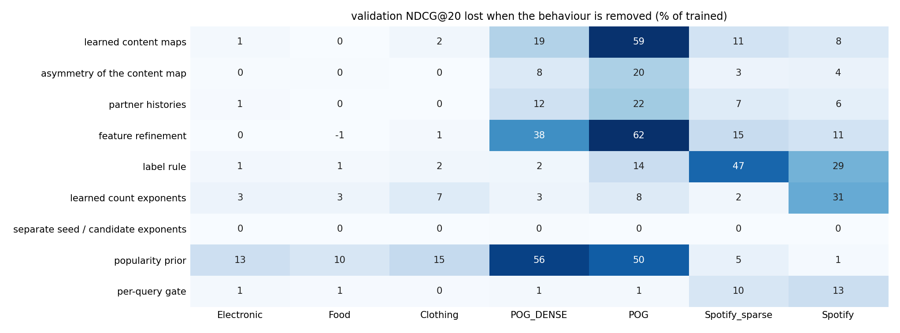
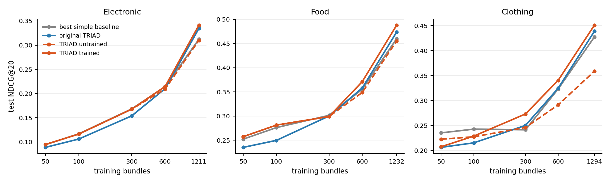

# TRIAD: how it is built from the simple scorer, and what its parameters learned

This document answers one question: **when TRIAD's training loss goes down, what pattern have its parameters latched
onto, and how does that pattern help the recommendations?**

- §1 defines the task.
- §2 builds TRIAD step by step from the simple scorer, defining every symbol where it first appears.
- §3 reads each learned part: the pattern, the evidence in the trained parameters, and how much it helps.
- §4 to §6 summarize the patterns, the contribution and the improvements the parameters suggest.
- §7 and §8 give the results and the limits.

---

## 1. The task

- A **catalogue** has $n$ items.
- A **bundle** is a set of items that belong together: products bought together (Electronic, Food, Clothing), an
  outfit (POG, POG_DENSE) or a playlist (Spotify, Spotify_sparse).
- A **query** shows part of a bundle, the **seeds** $S$. The rest of the bundle, the **targets**, is hidden.
- The model gives a score to **every** catalogue item $c$ (every **candidate**). A good model ranks the targets at the
  top.
- **NDCG@20** measures this. Look at the 20 highest-scored candidates. Each target found there earns credit, more
  credit the higher it ranks. The total is divided by the best possible total, so 1 means "all targets at the very
  top" and 0 means "no target in the top 20".

The data is split three ways:
- **training** bundles, which the model learns from;
- **validation** queries, used only to choose when to stop training;
- **test** queries, used only for the final results. "Clean" test queries are those whose full bundle does not also
  appear in training or validation.

---

## 2. Building TRIAD from the simple scorer

The simple scorer adds four signals: content, labels, counts and popularity. TRIAD keeps the same four signals and
gives each one learnable parameters. The parameters are set so that, before training, every signal equals its simple
version (§2.7).

### 2.1 Content: what the items look like

**The simple version.** Every item $c$ has a **feature vector** $x_c\in\mathbb R^{128}$, computed once from its image,
title or audio descriptors and scaled to length 1. The **bundle average** of the seeds is

```math
\bar x=\frac{1}{|S|}\sum_{s\in S}x_s ,
```

where $|S|$ is the number of seeds. The simple content score is the dot product of the bundle average with the
candidate's features:

```math
C^{\text{simple}}(S,c)=\bar x^\top x_c=\sum_{i=1}^{128}\bar x_i\,x_{c,i}.
```

It is high when the candidate looks like the seeds. Feature $i$ of the seeds is compared only with feature $i$ of the
candidate, and every feature counts equally.

**Step 1: a matrix in the middle.** The same score can be written with the $128\times128$ identity matrix,
$\bar x^\top I\,x_c$. TRIAD replaces $I$ by a learned $128\times128$ matrix $M$:

```math
\bar x^\top M\,x_c=\sum_{i=1}^{128}\sum_{j=1}^{128}\bar x_i\,M_{ij}\,x_{c,j}.
```

The entry $M_{ij}$ says how much "the seeds have feature $i$" should count towards "the candidate has feature $j$".
- $M=I$ gives back the simple score.
- A diagonal $M$ still means "looks like the seeds", but with some features counting more than others.
- Off-diagonal entries let "the seeds have feature $i$" call for a candidate with a *different* feature $j$, for example
  "the seeds look like a top, so prefer something that looks like trousers". The simple score cannot express this.

**Step 2: how $M$ is stored.** TRIAD stores two $128\times128$ matrices $A$ and $B$ and uses $M=A^\top B$:

```math
\bar x^\top A^\top B\,x_c=(A\bar x)^\top(Bx_c).
```

$A$ turns the bundle average into a "what the bundle is looking for" vector, and $B$ turns each candidate into a "what
this item offers" vector. The score is their dot product. Training starts from $A=B=\sqrt{10}\,I$, so $M=10I$: exactly
10 times the simple score. The factor 10 makes the scores sharper for the training loss (§2.6). It does not change the
ranking.

**Step 3: refined features $z$.** The features $x$ come from a generic encoder. They describe what an item looks like,
not the role it plays in a bundle. TRIAD lets a small neural network (an MLP) adjust them:

```math
z_c=\mathrm{normalize}\big(x_c+\mathrm{MLP}(x_c)\big),
```

where "normalize" rescales to length 1. The MLP's last layer starts at zero, so $z_c=x_c$ before training. The bundle
average of the refined features is written $\bar z$.

**Step 4: partner histories $h$.** Let $N_{cc'}$ be the number of training bundles that contain both $c$ and $c'$ (the
**co-occurrence count**). The **partner history** of $c$ is the average feature vector of the items $c$ was bundled
with, each counted as often as it was bundled with $c$:

```math
h_c=\frac{\sum_{c'}N_{cc'}\,x_{c'}}{\sum_{c'}N_{cc'}} .
```

It describes what $c$'s past partners look like. For an item that was never bundled, $h_c=0$. $\bar h$ is the bundle
average of the seeds' partner histories.

**Step 5: the full content score.** Each side of the dot product can now use an item's own refined features ($z$) or
its partners' features ($h$). That gives four matrices of the Step 1 kind, each stored as $A^\top B$ as in Step 2.
They are named by the **seed side first and the candidate side second**:

```math
C(S,c)=\underbrace{\bar z^\top M_{zz}\,z_c}_{\text{seeds' looks vs candidate's looks}}
+\underbrace{\bar z^\top M_{zh}\,h_c}_{\text{seeds' looks vs candidate's partners}}
+\underbrace{\bar h^\top M_{hz}\,z_c}_{\text{seeds' partners vs candidate's looks}}
+\underbrace{\bar h^\top M_{hh}\,h_c}_{\text{partners vs partners}} .
```

- **$M_{zz}$** is exactly the Step 1 matrix, applied to refined features. It starts at $10I$.
- $M_{hz}$ asks "does the candidate look like the things the seeds were bundled with before?". It can score a
  candidate that was never bundled, because $z_c$ always exists.
- $M_{zh}$ asks "do the seeds look like the candidate's usual partners?", and $M_{hh}$ asks "were the seeds and the
  candidate bundled with similar things?".
- $M_{zh}$, $M_{hz}$ and $M_{hh}$ start at 0. So before training, $C(S,c)=10\,\bar x^\top x_c$: 10 times the simple
  score.

**Step 6: reading a learned matrix, symmetric and antisymmetric parts.** Any square matrix $M$ splits into two parts:

```math
M=S_M+K_M,\qquad S_M=\tfrac12(M+M^\top),\qquad K_M=\tfrac12(M-M^\top).
```

- $S_M$ is **symmetric** ($S_M^\top=S_M$). Its score does not change when the roles of seed and candidate are swapped:
  $a^\top S_M b=b^\top S_M a$. It is a learned "how alike are these two".
- $K_M$ is **antisymmetric** ($K_M^\top=-K_M$). Swapping the roles flips the sign of its score:
  $a^\top K_M b=-\,b^\top K_M a$. It is the only part of $M$ that treats "the seeds" and "the candidate" differently.
- At the start $M_{zz}=10I$, so $S_M=10I$ and $K_M=0$.

This split is not a change to the model. It is a way to read what the learned $M_{zz}$ does (§3.4 and §3.5).

### 2.2 Labels: shared category, artist or album

**The simple version.** Each item has a **label** at one or more levels: its category (e-commerce, outfits), or its
artist and album (playlists). Let $m$ be the number of seeds that share the candidate's label. The simple label score
counts them, $L^{\text{simple}}(S,c)=m$: a shared label is always a bonus, of the same size for every label.

**TRIAD's version.** A small learned function $\delta$ (an MLP with one output) of three numbers:

```math
L(S,c)=\delta\big(\log(1+m),\ \log|S|,\ \log(1+n_g)\big)\quad\text{if } m>0,\qquad L(S,c)=0\ \text{otherwise}.
```

- $m$ is the number of seeds sharing the candidate's label.
- $|S|$ is the number of seeds.
- $n_g$ is the **label size**: how many catalogue items carry the candidate's label (a niche artist has a small
  $n_g$, a star a large one).

$\delta$ can be positive (a bonus) or negative (a penalty), and it can depend on the label size. There is one $\delta$
per label level (playlists have two: artist and album). Its last layer starts at zero, so $L=0$ before training.

### 2.3 Counts: how often the candidate was bundled with the seeds

**Popularity counts.** $f_c$ is the number of training bundles that contain $c$ ($f_c=0$: never bundled). The
**partner mass** $\deg_c=\sum_{c'}N_{cc'}$ counts $c$'s partners, each as often as it was bundled with $c$. A bundle
of size $k$ that contains $c$ adds 1 to $f_c$ and $k-1$ to $\deg_c$, so the two grow together.

**The simple version (ItemKNN).** Add up the co-occurrence counts with the seeds, each divided by the square root of
both items' popularity:

```math
G^{\text{simple}}(S,c)=\sum_{s\in S}\frac{N_{sc}}{\sqrt{f_s\,f_c}} .
```

This is the cosine of two items' bundle memberships. The division stops very popular items from winning just because
they appear everywhere.

**TRIAD's version.** The two square roots become learned exponents, one for the seed ($\alpha$) and one for the
candidate ($\beta$), using partner mass:

```math
G_{\text{counts}}(S,c)=\theta\,\log\Big(1+\sum_{s\in S}N_{sc}\,\deg_s^{-\alpha}\,\deg_c^{-\beta}\Big).
```

- $(\alpha,\beta)=(0,0)$: raw counts, so popular partners win.
- $(\alpha,\beta)=(\tfrac12,\tfrac12)$: cosine, the simple choice, and the start.
- $(\alpha,\beta)=(1,1)$: lift, meaning co-occurrence beyond what popularity explains.
- $\theta$ is a learned scale (starts at 1). The $\log(1+\cdot)$ damps very large sums.

### 2.4 Popularity prior: how likely an item is to be the missing one

**The simple version.** The best simple baselines add a **base rate**. Group items by $f$ (never bundled, bundled once,
twice, 3 to 4 times, and so on). For each group, compare its share of the validation targets with its share of the
catalogue:

```math
b(\text{group})=\log\frac{\text{share of validation targets in the group}}{\text{share of catalogue items in the group}} .
```

$b>0$ means the group's items are the missing item more often than their numbers suggest. The simple baselines read
$b$ off **validation** targets.

**TRIAD's version.** A small learned function $\rho$ (an MLP) of $\log(1+f_c)$, learned from **training bundles
only**. Its last layer starts at zero, so $\rho=0$ before training. In the current model $\rho$ is added to the counts,
in one **graph term**:

```math
G(S,c)=G_{\text{counts}}(S,c)+\rho\big(\log(1+f_c)\big).
```

### 2.5 Mixing the four signals: scaling and the gate

**Per-query scaling.** Each signal is divided by its largest absolute value over the catalogue, for this query:

```math
\widehat{T}(S,c)=\frac{T(S,c)}{\max_{c'}|T(S,c')|}\qquad\text{for } T=C,\ L,\ G .
```

Every signal then lies between −1 and 1, so the mixing weights compare like with like. The simple blend does the same.

**The gate.** The simple blend mixes the signals with fixed weights. TRIAD computes the weights per query:

```math
s(c\mid S)=w_C(S)\,\widehat{C}(S,c)+\sum_{\text{label levels}}w_L(S)\,\widehat{L}(S,c)+w_G(S)\,\widehat{G}(S,c).
```

The weights $w$ come from a small MLP of three numbers that describe the seeds:
- $\log|S|$ (how many seeds);
- the average of $\log(1+f_s)$ over the seeds (how familiar the seeds are);
- the share of seeds that were never bundled.

A softplus at the end ($\mathrm{softplus}(a)=\log(1+e^a)$) keeps every weight positive. The last layer starts at
weights 0 and bias $\log(e-1)$, which gives $w=1$ for every signal and every query.

### 2.6 Training

- **Loss.** Take a training bundle, hide some of its members, and score the whole catalogue from the rest. The loss is
  the negative log of the softmax probability of the hidden members over the catalogue. Lower loss means the hidden
  members get a larger share of the probability.
- **Leave-one-out.** While a bundle is being scored, its own co-occurrences are removed from $N$, $f$, $\deg$ and $h$.
  Otherwise the model could read the hidden members off counts that include this very bundle.
- **Stopping.** After each pass over the training bundles (an **epoch**), compute validation NDCG@20. Training stops
  when it has not improved for several epochs, and the best epoch is kept.
- 74,136 trained parameters in all, none of them tied to a particular item.

### 2.7 Before training, TRIAD is the simple scorer

| Part | Start | Effect |
|---|---|---|
| Refined features | MLP last layer $=0$ | $z=x$ |
| Content matrices | $M_{zz}=10I$; $M_{zh}=M_{hz}=M_{hh}=0$ | $C=10\,\bar x^\top x_c$ (simple content) |
| Label rule | $\delta=0$ | $L=0$ |
| Count exponents | $\alpha=\beta=\tfrac12$, $\theta=1$ | cosine co-occurrence |
| Popularity prior | $\rho=0$ | no prior |
| Gate | $w=1$ | equal mix |

So the untrained model is an equal mix of simple content and cosine co-occurrence. On Electronic and Food it is within
.007 test NDCG@20 of the best validation-tuned simple baseline at every training size. **Everything TRIAD does beyond
the simple scorer was learned.**

---

## 3. What each part learned

**How the evidence is measured.**
- The models are trained on full data with three seeds (three random starts). Everything here is measured on
  validation queries, never on test, and no parameter is set from it.
- **"Worth"** is how much validation NDCG@20 drops when that one learned pattern is removed from the trained model
  (for example, putting $\delta$ back to 0), as a share of the trained model's score, averaged over the three seeds.
  This is called a **knock-out**.
- The datasets are grouped as **e-commerce** (Electronic, Food, Clothing), **outfits** (POG_DENSE, POG) and
  **playlists** (Spotify_sparse, Spotify). Numbers in a row follow that order.
- Code: `analysis/readings.py`, `analysis/extra.py` and `analysis/taste.py`; outputs in `results/`.

### 3.1 Popularity prior $\rho$: learns the base rate from training alone

**Pattern.** How likely an item is to be the missing piece, as a function of how often it was bundled. It rises
steeply with popularity, **with a dip**: items bundled exactly once are less likely targets than never-bundled ones.

**Evidence.** $\rho$ never sees validation, yet it matches the validation base rate $b$ (§2.4). Correlation of $\rho$
with $b$ over the frequency groups:

| Electronic | Food | Clothing | POG_DENSE | POG | Spotify_sparse | Spotify |
|---|---|---|---|---|---|---|
| .96 to .97 | .98 to .99 | (only 2 groups) | .99 | .99 to 1.00 | .96 | .82 to .86 |

POG_DENSE, group by group:

| bundled ($f$) | 0 | 1 | 2 | 3-4 | 5-9 | 10-19 | 20-49 | 50+ |
|---|---|---|---|---|---|---|---|---|
| validation base rate $b$ | +0.09 | **−1.77** | −0.63 | +0.08 | +0.76 | +1.60 | +2.48 | +5.05 |
| learned $\rho$ (seed 0) | 2.47 | **1.94** | 2.25 | 2.44 | 2.63 | 2.82 | 3.02 | 3.48 |

Only the shape matters ($\rho$ is rescaled with the counts in §2.5), and the shape matches, dip included.

**Worth:** **13%, 10%, 15%** | **56%, 50%** | 5%, 1%. It is the most important single part on all three e-commerce
sets and on POG_DENSE.

**Exception.** On full Spotify, $\rho$ follows $b$ up to 10 to 19 bundles, then flattens (seed 0: 1.39, 1.39, 1.25)
while $b$ keeps rising to +3.45.

### 3.2 Label rule $\delta$: a shared label helps or hurts depending on the domain; rare labels say more

**Pattern.** Whether sharing a label with a seed makes an item more or less likely to be missing, and how that depends
on the label size $n_g$.

**Evidence.** $\delta$ for one shared seed ($m=1$) and the typical number of seeds, at three label sizes: small,
medium and large (the 10th, 50th and 90th percentile of the label sizes of catalogue items):

| Dataset (label) | label sizes $n_g$ | learned $\delta$ |
|---|---|---|
| Food (category) | 2 → 10 → 84 | **+.50 → +.32 → +.10** (seed 0): a bonus, weaker for big categories, the same shape in all seeds |
| Electronic, Clothing (category) | 3 → 20 → 61; 1 → 3 → 31 | **positive** for small categories in every seed (.06 to .28); for the largest categories the sign differs between seeds |
| POG_DENSE (category) | 345 → 1,483 → 4,615 | **−80 → −103 → −121**: a strong penalty, stronger for big categories |
| POG (category) | 403 → 2,035 → 5,433 | **−10 → −14 → −17**: the same |
| Spotify_sparse (artist) | 1 → 15 → 83 tracks | **+1.54 → +.79 → +.43**: a bonus, weaker for big artists |
| Spotify (artist) | 2 → 17 → 91 tracks | **+1.39 → +.81 → +.45**: the same |
| Spotify sets (album) | 1 → 3 → 13 tracks | **+1.0 to 1.5 → +.3 to .4 → +.1 to .2** |

The data agrees. On validation, targets share a label with a seed 15 to 50 times more often than random items do in
e-commerce, and about 100 to 160 times more often for artists. In outfits they almost never do (0.05% or less, although
7 to 13% of the catalogue would). An outfit's missing piece is a different category. A playlist's next track is often
by the same artist, and a niche artist is stronger evidence than a star: the same reason search engines count rare
words more than common ones.

**Worth:** 1%, 1%, 2% | 2%, 14% | **47%, 29%**.

### 3.3 Count exponents $\alpha,\beta$: a much weaker popularity discount than cosine

**Pattern.** How much a co-occurrence count should be discounted by the popularity of the two items (§2.3).

**Evidence:**

| | Electronic | Food | Clothing | POG_DENSE | POG | Spotify_sparse | Spotify |
|---|---|---|---|---|---|---|---|
| $\alpha$ (seed side) | .48 | .34 | .15 | .37 | .25 | −.03 | .11 |
| $\beta$ (candidate side) | .18 | .17 | .12 | .37 | .26 | .01 | .09 |

The candidate-side discount $\beta$ moved from the starting ½ towards raw counts (0) on every dataset, and playlists
went almost all the way on both sides. In bundle completion a popular candidate really is more likely to be added
(§3.1), so cosine's strong discount throws evidence away. On the seed side, Electronic stays near ½ ($\alpha=.48$).

**Worth.** The counts and $\rho$ sit in one term $G$ that is scaled as a whole (§2.5), so changing the exponents also
changes how much $\rho$ counts. To measure the exponents alone, $\rho$ is removed first. Putting the exponents back to
½ then costs 0 to 1% | **16%, 5%** | **13%, 5%**.

**Not needed:** a different discount for seed and candidate. Electronic and Food learn $\alpha>\beta$ in every seed
(a popular seed is discounted more than a popular candidate), but replacing $\alpha$ and $\beta$ by their average
costs 0% on every dataset.

### 3.4 Content matrix $M_{zz}$, symmetric part $S_M$: look-alikes help in e-commerce, not in outfits

**Pattern.** Whether looking like the seeds makes an item a good addition.

**Evidence.** Two readings of the learned $M_{zz}$ (§2.1):
- **Change from the start:** $\lVert M_{zz}-10I\rVert/\lVert 10I\rVert$, where $\lVert\cdot\rVert$ is the size of a
  matrix (the square root of the sum of its squared entries). 0 means unchanged, 1 means it moved by its own size.
- **Agreement with the simple score among look-alikes:** for each item, take its 10 most similar items by refined
  features; across these pairs, the correlation between the learned score $z_a^\top M_{zz}z_b$ and the simple score
  $z_a^\top z_b$. 1 means the learned matrix still ranks look-alikes the simple way.

| | Electronic | Food | Clothing | POG_DENSE | POG | Spotify_sparse | Spotify |
|---|---|---|---|---|---|---|---|
| change from start | .15 | .10 | .17 | 1.09 | 1.01 | .46 | .53 |
| agreement among look-alikes | .97 | .99 | .93 | .19 | **−.17** | .26 | **−.05** |

- **E-commerce:** $M_{zz}$ stays at its start. Related products are well served by "looks like the seeds".
- **Outfits and playlists:** $M_{zz}$ moved by about its own size (outfits), and among near look-alikes it no longer
  follows the simple score, on POG even reversing it. The data agrees: the simple content score puts **no** outfit
  target among its 20 highest-scored items.

**Worth** (all four content matrices back to their start): 1%, 0%, 2% | **19%, 59%** | **11%, 8%**.

### 3.5 Content matrix $M_{zz}$, antisymmetric part $K_M$: a fixed taste over candidates

**Pattern.** $K_M$ (§2.1, Step 6) learned **one fixed preference over candidates, the same in every query**.

**Why it can act that way.** Let $\mu$ be the average refined feature vector over the whole catalogue. Write the
bundle average as $\bar z=\mu+(\bar z-\mu)$. The part of the content score that comes from $K_M$ then splits into two:

```math
\bar z^\top K_M\,z_c=\underbrace{\mu^\top K_M\,z_c}_{\text{same for every query}}\;+\;\underbrace{(\bar z-\mu)^\top K_M\,z_c}_{\text{depends on the seeds}} .
```

The first piece does not depend on the seeds. It is a fixed preference over candidates, along the direction
$K_M^\top\mu$ in feature space. The second piece is a relation between these particular seeds and the candidate.

**Evidence.**
- **Which piece is used:** keeping only the first piece loses nothing. Keeping only the second loses as much as
  removing $K_M$ altogether (8% on POG_DENSE, 21% on POG). So the model uses $K_M$ only as the fixed preference.
- **It is a real pattern:** the preference each item gets correlates .84 to .89 between the three seeds (POG_DENSE).
- **What it prefers (POG_DENSE):** at the top, **sneakers** (dad shoes, Air Jordan, Converse, white sneakers),
  **hoodies and dresses**. At the bottom, **small accessories**: hats (berets, straw hats, caps), bracelets and
  bangles, necklaces, earrings, watches, and sandals and slippers.
- **It is not popularity:** its correlation with $\log(1+f_c)$ is −.06 to .11.
- **Where it acts:** take any target and any non-target; the **AUC** is the chance that the target gets the higher
  preference (.5 = no better than a coin). Over the whole catalogue the AUC is .45 to .56: no help. Inside each
  query's **shortlist** (the 100 candidates the rest of the model ranks highest) it is .60 to .67 on outfits, and
  there its spread (standard deviation over the 100) is about as large as the spread of the rest of the score. So it
  re-orders candidates that the counts and the prior have already made plausible.

**Worth:** 0%, 0%, 0% | **8%, 20%** | 3%, 4%.

**Not yet explained:** per category, the hit rate inside the shortlist does not follow the preference (correlation
.03). So it works item by item, not as a plain "clothes beat accessories" rule.

### 3.6 Partner histories ($M_{zh}$, $M_{hz}$, $M_{hh}$): what the seeds were bundled with

**Pattern.** "Does the candidate look like the things the seeds were bundled with before?" and the reverse. This
carries co-occurrence over to items that look alike, including items never bundled.

**Evidence.** The share of the content score's spread over each query's shortlist that comes from the three blocks
with partner histories:

| Electronic | Food | Clothing | POG_DENSE | POG | Spotify_sparse | Spotify |
|---|---|---|---|---|---|---|
| .12 | .08 | .12 | **.69** | **.51** | **.65** | **.62** |

**Worth:** 1%, 0%, 0% | **12%, 22%** | **7%, 6%**.

### 3.7 Refined features $z$: features reshaped for bundling

**Pattern.** The generic features are adjusted towards the role an item plays in a bundle (§2.1, Step 3).

**Evidence.** The average cosine between refined and original features ($z_c^\top x_c$, 1 = unchanged) is .86 to
.93 in e-commerce and POG_DENSE, and .62 to .75 on POG and the Spotify sets.

**Worth:** about 0 (e-commerce, −1 to 1%) | **38%, 62%** | **15%, 11%**. The content matrices are built on top of $z$, so the
value of the two cannot be separated.

### 3.8 Gate $w$: trust content more when the seeds are new

**Pattern.** When the seeds were never bundled, their counts are zero and their partner histories are empty, so
content is the only signal left that is specific to the query. The gate learned to raise content's weight $w_C$ then.

**Evidence.** $w_C$ for a query whose seeds are all new, against one with no new seeds (other inputs typical):
**+36%, +42%, +78%** | −1%, +4% | **+47%, +78%**.

**Worth** (gate fixed at its average weights): 1%, 1%, 0% | 1%, 1% | **10%, 13%**.

---

## 4. The patterns, per domain



*Validation NDCG@20 lost when one learned pattern is removed, as a percentage of the trained model's score.*

- **E-commerce (related products):** keeps simple content and counts; learns a same-category **bonus**, a strong
  popularity prior, and more weight on content for new seeds.
- **Outfits (complements):** look-alikes are not wanted. Learns a strong same-category **penalty**; content that stops
  rewarding near look-alikes and leans on partner histories and refined features; a fixed taste for main pieces over
  small accessories; and a very strong popularity prior.
- **Playlists:** almost raw counts; an artist and album **bonus that is stronger for niche artists**; refined
  features; partner histories; and more weight on content for new seeds.

---

## 5. The contribution

1. **The simple scorers' fixed choices are parameters of one model, and the model starts at the simple scorer**
   ($M_{zz}=10I$, $\alpha=\beta=\tfrac12$, $\delta=\rho=0$, $w=1$). Training moves each one only where the data
   supports it: with 50 to 300 training bundles (Electronic, Food), validation keeps the untrained model in every
   seed.
2. **What it learns is real domain knowledge, readable from the parameters:**
   - a shared label flips sign between product, outfit and playlist bundles, and niche artists count more;
   - popularity is evidence for being added, so the count discount should be much weaker than cosine;
   - the base rate of being the missing item, dip included, can be learned from training bundles alone (the simple
     baselines take it from validation);
   - for complements, content works through "looks like what the seeds were bundled with", not "looks like the seeds".
3. **Different domains use different parts**, so no single fixed scorer suits all of them.
4. **Result:** significantly ahead of the best validation-tuned simple baseline on all seven datasets (§7).

Not a contribution: each mechanism alone is simple and has precedents, and two parts do not do what they were
designed for. The separate seed and candidate exponents are unused, and $K_M$ is used as a fixed taste, not as a
relation between seeds and candidate.

---

## 6. Improvements the parameters suggest (future work)

1. **Give the prior its own term.** $\rho$ shares the scaled term $G$ with the counts, so changing one changes the
   other's weight (on full Spotify, putting the exponents back to ½ costs 31% with $\rho$ and 5% without it). A
   separate term $\widehat{P}$ with its own gate weight would let the gate set the balance.
2. **Make the taste explicit.** $K_M$ is used only as the direction $K_M^\top\mu$. It could be replaced by an
   explicit term $u^\top z_c$, with $u\in\mathbb R^{128}$ learned (starting at 0), added to the prior, keeping only
   $S_M$ in $M_{zz}$. Unlike $\rho$, which gives every never-bundled item the same score, $u^\top z_c$ can tell new
   items apart by their features.
3. **One exponent**, $\alpha=\beta$, since the split is unused.

Each change would keep the untrained model unchanged. They are not part of this model.

---

## 7. Results

Test NDCG@20 on clean test queries, full training data, average of three seeds (0, 1, 2). Significance: paired tests
over queries (bootstrap and sign-flip), corrected for multiple comparisons (Holm: 10 tests over the first five
datasets, 2 per Spotify set). "Best simple" is the best simple baseline per dataset, chosen on validation, with the
popularity prior allowed. "Original TRIAD" is the earlier version (rank-64 content, raw-count start, no per-query
scaling), with the same features as TRIAD in every row (BLIP title features on e-commerce).

| Dataset | Test queries | Best simple | Original TRIAD | TRIAD | TRIAD − best simple | TRIAD − original |
|---|---|---|---|---|---|---|
| Electronic | 346 | .312 | .335 | **.341** | **+.029** | +.007 (n.s.) |
| Food | 353 | .460 | .474 | **.488** | **+.028** | **+.014** |
| Clothing | 371 | .427 | .439 | **.451** | **+.024** | +.012 (n.s.) |
| POG_DENSE | 5,547 | .241 | .278 | **.280** | **+.039** | **+.002** |
| POG | 3,995 | .023 | .031 | .031 | **+.007** | +.000 (n.s.) |
| Spotify_sparse | 2,497 | .209 | .256 | .257 | **+.048** | +.000 (n.s.) |
| Spotify | 3,995 | .247 | .282 | .282 | **+.036** | +.000 (n.s.) |

Bold differences are significant; n.s. = not significant.

**Training setting.** On the three small e-commerce sets (about 1,200 training bundles) both learning rates are
halved. With the default rates the model moved so far in its first one or two epochs that validation could not tell
a good early model from a bad one, and test NDCG@20 varied by up to .06 between seeds on Food. The halved rates were
chosen on validation (five seeds on the three sets), not on test. POG_DENSE, POG and the Spotify sets use the default
rates.

**Where the numbers come from:** `python -m analysis.tables results` (output `results/table.json`), from
`runs/<dataset>` (TRIAD), `runs/baselines` (`python -m triad baselines`) and the original TRIAD's runs. TRIAD's
e-commerce runs were trained with this repository's code (`python -m triad train`). The POG_DENSE, POG and Spotify
runs were trained before this repository took the model over, by earlier scripts with the same model and training
loop; `python -m triad test` reproduces their test numbers exactly.



*Test NDCG@20 against the number of training bundles (e-commerce; nested random subsets, seeds 0 to 2). Grey: best
simple baseline. Blue: original TRIAD. Dashed orange: TRIAD untrained. Solid orange: TRIAD trained.*

- With 50 to 300 bundles on Electronic and Food, validation keeps the untrained model (epoch 0) in every seed, so TRIAD
  stays the simple scorer. With more bundles it moves away and pulls ahead.
- Over the 15 conditions (Holm over 15 tests per model), TRIAD is significantly ahead of the best simple baseline in 5
  and behind in 2 (Clothing with 50 and 100 bundles). The original TRIAD is ahead in none and behind in 4.
- Code: `python -m analysis.tables training_size` (output `results/training_size.json`).

---

## 8. Limits

- The evidence is on validation, for models chosen on validation. It shows what the models use; it is not a test claim.
- A knock-out removes one part at a time and can miss parts that stand in for each other. Where this mattered (counts
  and prior), they were removed together.
- Open questions: why outfits do not use the gate; why the label penalty is worth only 2% on POG_DENSE; why $\rho$
  flattens for the most popular items on full Spotify; and why the fixed taste helps item by item when per-category
  hit rates do not follow it.
