# TRIAD, explained with figures

This document explains TRIAD with pictures. Part 1 follows one real test query through the model and shows how its
score is made. Part 2 shows what each part of the model learned and what that says about the data. Part 3 shows the
results. Each figure comes first, then how to read it, then what it shows.

TRIAD_DESIGN.md has the full derivation and the exact tables. This document uses the same numbers.

**Where the numbers come from.** Nothing here was retrained. The figures are drawn from saved files:

- `results/readings.json`, `results/readings_extra.json` and `results/taste.json`: readings of the trained models
  (seeds 0, 1 and 2) on validation queries, never on test (TRIAD_DESIGN.md §3).
- `runs/pog_dense/seed0/model.pt`: the trained POG_DENSE model, for the worked example in Part 1.
- bundlefuse `results/small_data/table_final.json` and `cold_sparse_check.json`: the test results (RESULTS.md §2 and
  §6).

`PYTHONPATH=. ../bundlefuse/.venv/bin/python -m analysis.explained_figures` redraws every figure in
`figures/explained/`.

**The seven datasets fall into three domains.** The figures always list them in this order:

| Domain | Datasets | What a bundle is |
|---|---|---|
| e-commerce | Electronic, Food, Clothing | products bought together |
| outfits | POG_DENSE, POG | pieces worn together (top, trousers, shoes, bag) |
| playlists | Spotify_sparse, Spotify | tracks in one playlist |

**Words used throughout.**

- **Seeds** $S$: the items of a partial bundle that we are given.
- **Hidden items**: the items left out of the bundle, which the model has to find.
- **Candidate** $c$: any catalogue item the model scores.
- $f_c$: the number of training bundles that contain item $c$. An item with $f_c=0$ was never in a training bundle.

---

## Part 1. How TRIAD scores one query

### 1.1 The parts of the score

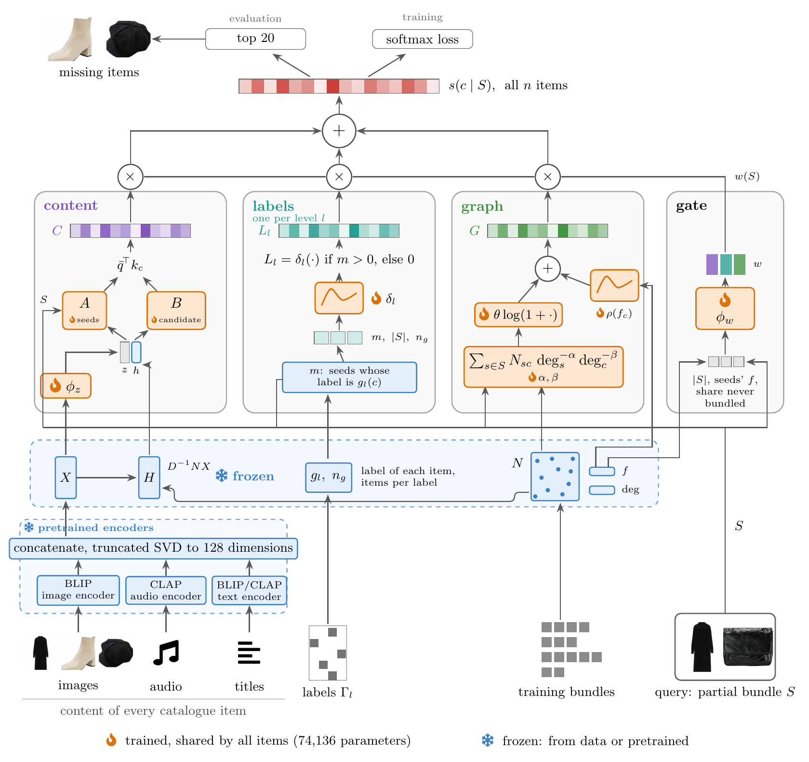

For a query with seeds $S$, TRIAD gives every catalogue item $c$ a score from three parts:

- **Content** $C(S,c)$: does $c$ fit what the seeds look like, and what they were bundled with before?
- **Label** $L(S,c)$: does $c$ share a category (or artist, or album) with a seed? If not, this part is 0. If it does,
  the small network $\delta$ decides how much that counts, as a bonus or a penalty.
- **Graph** $G(S,c)$: how often was $c$ bundled with the seeds in training, plus a popularity prior $\rho(f_c)$?

Two more steps happen before the parts are added up (the figure shows the second as the $\times$ circles at the top):

1. **Per-query scaling.** Each part is divided by its own largest absolute value over the whole catalogue, for this
   query. After this, every part lies between −1 and 1.
2. **Gate.** A small network looks at three facts about the seeds: how many there are, how often they were bundled,
   and how many were never bundled. It gives each part a weight $w$ for this query.

The final score is $s(c\mid S)=w_C\,\hat C+w_L\,\hat L+w_G\,\hat G$, where the hat means "after scaling". The highest
scores are the model's guesses.

### 1.2 One real query, step by step

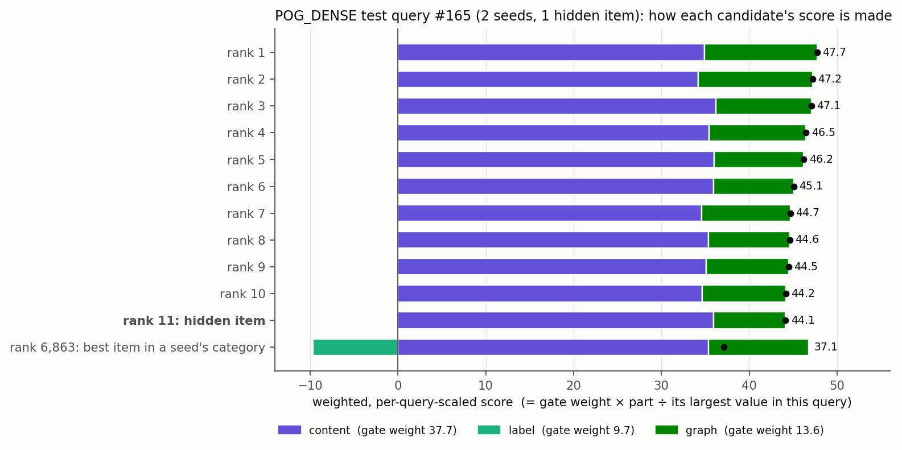

**The query.** POG_DENSE (outfits, 31,217 items), the trained model of seed 0. The query was picked by a fixed rule,
not by hand: the clean test query whose NDCG@20 is closest to the dataset's average (query #165, NDCG@20 .279 against
an average of .282). So it is a typical query.

| | Item | Category (items in it) | Training bundles $f$ |
|---|---|---|---|
| seed 1 | 10091 | 2 (3,640) | 12 |
| seed 2 | 30318 | 27 (739) | 739 |
| **hidden item** | **16088** | **7 (3,221)** | **3** |

**How to read the figure.** Each row is one candidate. The bar is its final score, split into the three parts:
violet for content, aqua for label and green for graph. Each segment is already weighted and scaled, so the segments
add up to the final score (the black dot and the number). Rows 1 to 10 are the model's top 10. Then come the hidden
item (rank 11) and, for contrast, the best-ranked item from one of the seeds' categories (rank 6,863).

**Step 1: the gate sets the weights.** This query has 2 seeds, both well known (bundled 12 and 739 times) and none
new. The gate gives content 37.7, label 9.7 and graph 13.6. These weights are what make the scores spread far apart.

**Step 2: content.** The hidden item's raw content score is 7.08. The largest raw content score in the catalogue for
this query is 7.42. So its scaled score is 7.08 / 7.42 = 0.954, and its violet segment is 0.954 × 37.7 = **36.0**.
For comparison, ranking by plain similarity of the item features would put the hidden item at rank 18,283. The learned
content part alone puts it at rank 35.

**Step 3: label.** The hidden item is in category 7, and neither seed is. So its label part is exactly 0: no aqua
segment. But 4,377 other items share a category with a seed (3,639 in category 2 and 738 in category 27). For them
$\delta$ is strongly negative: −117.65 for category 2 and −92.35 for category 27. The largest absolute label value is
117.65, so after scaling these become −1.00 and −0.78, and after the weight −9.7 and −7.6. That is the aqua segment
pointing left in the last row. It pushes every one of the 4,377 items down: the best of them is at rank 6,863. In an
outfit, a piece from a category the outfit already has is rarely the missing one.

**Step 4: graph.** The hidden item has a small co-occurrence part (0.33, since it was in only 3 training bundles) and
a prior $\rho$ of 2.41, together 2.74. The largest graph value in the query is 4.55, so it scales to 0.602, and its
green segment is 0.602 × 13.6 = **8.2**.

**Step 5: add up and rank.** 36.0 + 0 + 8.2 = **44.1**, rank 11. One hidden item at rank 11 gives
NDCG@20 = 1 / log₂(12) = .279.

**What the figure shows about who wins.**

- The violet segments are almost the same length in every row (34 to 36). Content has the biggest weight, but it
  does not separate the top candidates: they all fit the seeds about equally well.
- The green segments differ much more (8 to 13). So among candidates that fit equally well, the graph part decides.
- The hidden item fits as well as the top items (violet 36.0), but its green segment is short, because it was rarely
  bundled with these seeds. That is why it is at rank 11 and not in the top 3.

---

## Part 2. What each part learned

**How these readings are made.** Each figure reads the trained models of seeds 0, 1 and 2 on validation queries
(TRIAD_DESIGN.md §3). Where a figure shows a bar or a large marker, it is the mean of the three seeds. The small dots
are the seeds themselves, so you can see whether they agree.

### 2.1 Popularity prior $\rho$: it learns how likely an item is to be the missing one

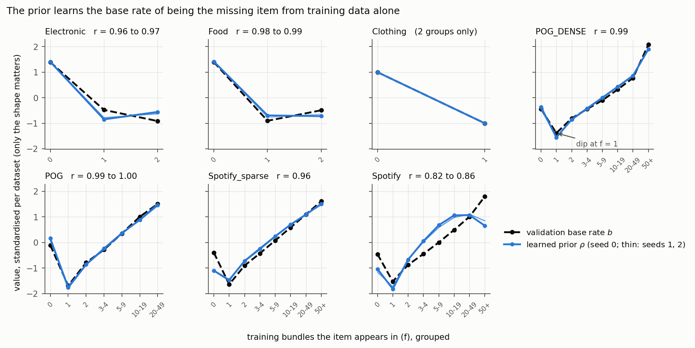

**What is compared.** Items are grouped by how many training bundles they appear in ($f$ = 0, 1, 2, 3-4, and so on).
For each group there are two numbers:

- the **validation base rate** $b$ (black dashed line): how much more or less often items of this group are hidden
  items in validation than their share of the catalogue would suggest (TRIAD_DESIGN.md §2.4);
- the **learned prior** $\rho$ (blue lines): the average $\rho(f_c)$ the model gives the items of this group. It is
  learned from training bundles only and never sees validation.

The two are on different scales, so each line is standardised within its dataset: its mean is subtracted and it is
divided by its spread. This keeps the shape and removes the scale. A group is shown only if it has at least 20 items
and 20 validation targets, so the panels have different numbers of groups. The title gives the correlation $r$ between
$\rho$ and $b$ over the groups (range over the three seeds).

**What it shows.**

- The blue lines follow the black ones closely: $r$ = .96 to 1.00 everywhere except full Spotify (.82 to .86).
- **E-commerce:** never-bundled items ($f=0$) are the most likely hidden items, and $\rho$ learns this.
- **Outfits and playlists:** a clear **dip at $f=1$**. Items bundled exactly once are less likely hidden items than
  never-bundled ones, and above $f=1$ the chance rises steadily with popularity. $\rho$ learns the dip too.
- **Full Spotify** is the exception: $\rho$ follows $b$ up to 10-19 bundles, stays level at 20-49 and falls at 50+,
  while $b$ keeps rising.

**How much it matters** (knock-out, see 2.8): 13%, 10%, 15% in e-commerce and 56%, 50% on outfits. It is the most
important single part on all three e-commerce sets and on POG_DENSE.

### 2.2 Label rule $\delta$: a shared label is a bonus or a penalty, depending on the domain

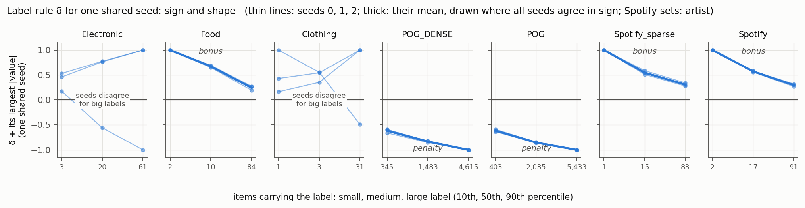

**What is plotted.** The network $\delta$ is run on fixed inputs: one seed shares the candidate's label ($m=1$), the
typical number of seeds, and three label sizes. The label sizes are small, medium and large: the 10th, 50th and 90th
percentile of how many catalogue items carry the label of an item. The x-axis shows these sizes. For example, on
POG_DENSE a small category has 345 items and a large one has 4,615.

**Why each line is divided by its largest absolute value.** Inside the model, the label part is divided by its largest
value in every query (Part 1, scaling). So the overall size of $\delta$ never affects a ranking. Only two things do:
its **sign** (above or below 0, where items without a shared label sit) and the **ratios** between its values. Dividing
by the largest absolute value keeps exactly these two and removes the rest.

**What it shows.**

- **Outfits: penalty.** All three seeds are below 0 at every size, and most negative for big categories. A candidate
  from a category a seed already has is pushed down, as in Part 1.
- **Playlists: bonus, larger for small labels.** All seeds are above 0. A track by an artist with 1 or 2 tracks in the
  catalogue gets about 3 to 4 times the bonus of a track by an artist with 83 to 91 tracks. A match on a niche artist
  is strong evidence, while a match on a big artist happens often by chance.
- **Food: the same shape**, a bonus that shrinks for big categories.
- **Electronic and Clothing: no firm reading.** For small categories every seed gives a bonus. For big categories the
  seeds disagree in sign, so there is no mean line, and the figure says "seeds disagree".

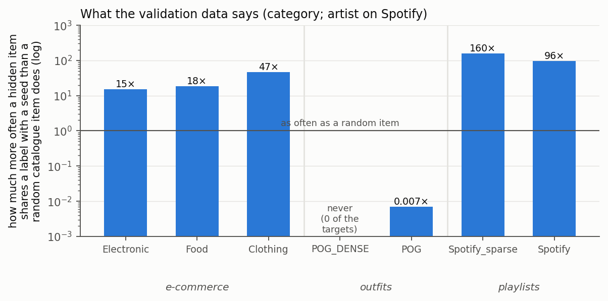

**The data agrees.** This second figure is computed from the validation data, not from the model. It shows how much
more often a hidden item shares a label with a seed than a random catalogue item does (log scale; 1 means "as often as
chance").

- E-commerce: 15 to 47 times more often.
- Playlists (artist): about 100 to 160 times more often.
- Outfits: almost never. On POG_DENSE no hidden item in validation shares a seed's category, and on POG it is 0.007
  times the chance rate. An outfit's missing piece is a different kind of item.

**How much it matters:** 47% and 29% on the playlists, 14% on POG, and 1 to 2% elsewhere.

### 2.3 Count exponents $\alpha,\beta$: popularity should be discounted much less than cosine does

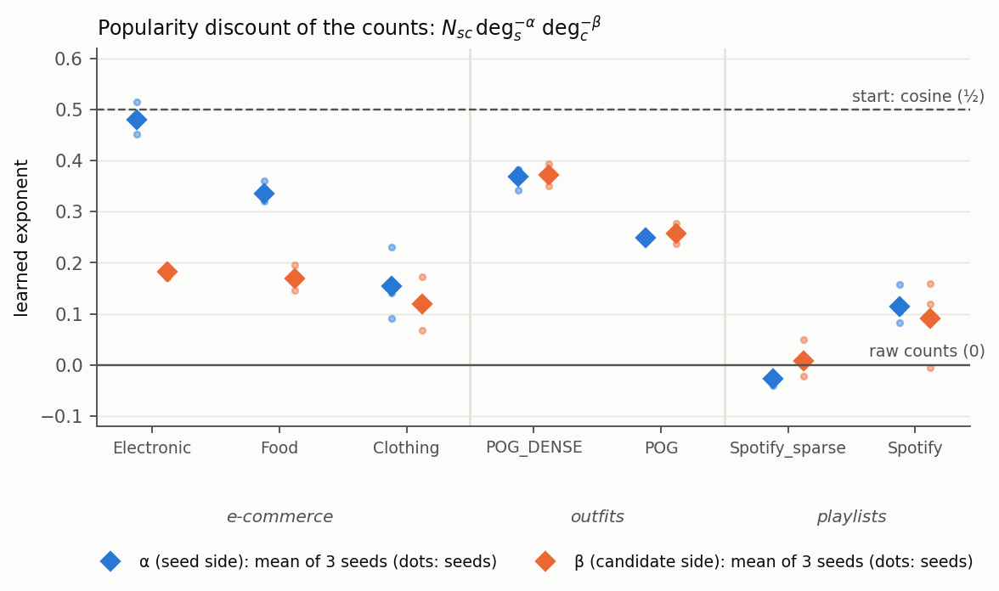

**What the exponents do.** The graph part counts how often a candidate $c$ was bundled with each seed $s$ ($N_{sc}$)
and divides by the two items' popularity: $N_{sc}\,\deg_s^{-\alpha}\,\deg_c^{-\beta}$, where $\deg$ counts an item's
bundle partners. With $\alpha=\beta=\tfrac12$ this is the cosine similarity of co-occurrence, which is where the model
starts (dashed line). With both at 0 it is raw counts (solid line).

**What it shows.**

- The candidate exponent $\beta$ (orange) fell from ½ towards 0 on every dataset. Playlists went almost all the way to
  raw counts on both sides. A popular candidate really is more likely to be added (2.1), so a strong discount throws
  that evidence away.
- On the seed side, Electronic stays near ½ ($\alpha$ = .48), and e-commerce generally has $\alpha$ above $\beta$.
- **The split is not needed:** replacing $\alpha$ and $\beta$ by their average costs 0% on every dataset (row
  "separate seed / candidate exponents" in 2.8).

### 2.4 Content matrix $M_{zz}$: look-alikes help in e-commerce, not in outfits

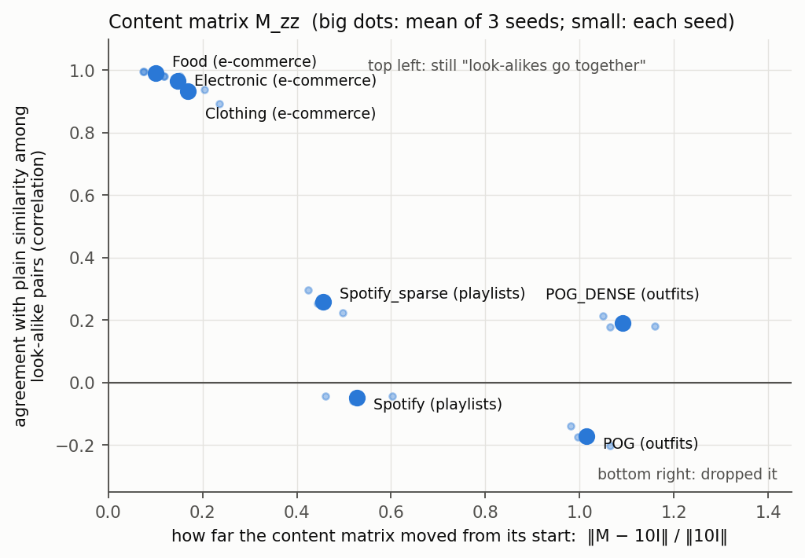

**The two measures.**

- **x-axis, how far the matrix moved:** $\lVert M_{zz}-10I\rVert/\lVert 10I\rVert$. The model starts at $M_{zz}=10I$
  (plain similarity). 0 means unchanged, and 1 means it moved by its own size.
- **y-axis, agreement among look-alikes:** for each item, take its 10 most similar items. Over these pairs, compute the
  correlation between the learned content score and plain similarity. 1 means the learned matrix still ranks
  look-alikes the plain way. 0 or below means it no longer does.

**What it shows.** The datasets fall into three clear groups:

- **E-commerce (top left):** the matrix barely moved (.10 to .17) and still agrees with plain similarity (.93 to
  .99). For related products, "looks like the seeds" works.
- **Playlists (middle):** moved by about half its size and mostly stopped following plain similarity (.26 and −.05).
- **Outfits (right):** moved by about its full size, and among near look-alikes it no longer follows plain similarity
  (.19), on POG even slightly reversing it (−.17). An outfit is completed by a different piece, not by a twin. In the
  data, plain similarity puts no outfit target in its top 20 at all.

**How much it matters** (all four content matrices back to their start): 19% and 59% on outfits, 11% and 8% on
playlists, 0 to 2% in e-commerce.

### 2.5 Partner histories: "what the seeds were bundled with"

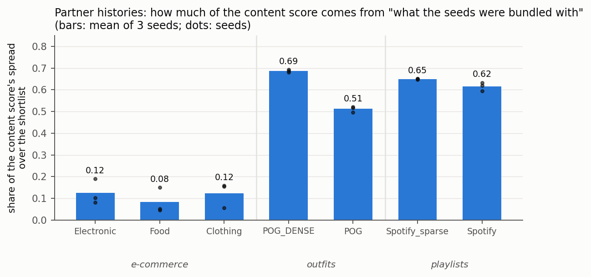

**What it measures.** Besides the item features $z$, the content part can use each item's **partner history** $h$:
the average features of the items it was bundled with in training. This asks "does the candidate look like the things
the seeds were bundled with?" and the reverse. The bar is the share of the content score's spread over each query's
shortlist (the 100 best candidates) that comes from these history blocks.

**What it shows.** About a tenth in e-commerce (.08 to .12), but half to two thirds on outfits (.51, .69) and playlists
(.62, .65). Where look-alikes do not go together (2.4), content works through partners instead: a candidate scores
well if it looks like the things the seeds were bundled with.

**How much it matters:** 12% and 22% on outfits, 7% and 6% on playlists, 0 to 1% in e-commerce.

### 2.6 The fixed taste $K_M$: a preference that only helps inside the shortlist

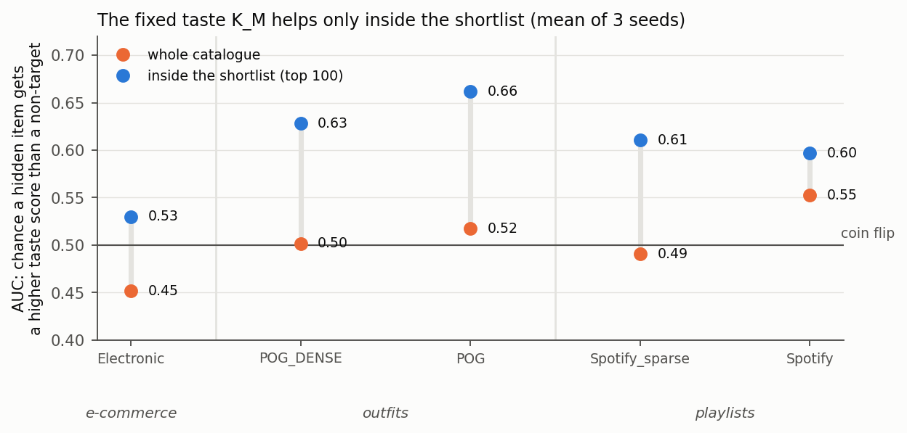

**What it is.** The antisymmetric part of $M_{zz}$ ($K_M$, TRIAD_DESIGN.md §3.5) ended up acting as one fixed
preference over candidates, the same in every query. On POG_DENSE it prefers sneakers, hoodies and dresses over small
accessories.

**What is plotted.** The AUC is the chance that a hidden item gets a higher preference than a non-target (.5 is a coin
flip). The orange dot uses the whole catalogue and the blue dot only the 100 candidates the rest of the model ranks
highest. This reading exists for these five datasets only.

**What it shows.** Over the whole catalogue the preference is about a coin flip (.45 to .55). Inside the shortlist it is
.60 to .66 on outfits and playlists. So it does not find hidden items by itself. It re-orders candidates that the
counts and the prior have already made plausible.

**How much it matters:** 8% and 20% on outfits, 3% and 4% on playlists, 0% in e-commerce.

### 2.7 Gate: trust content more when the seeds are new

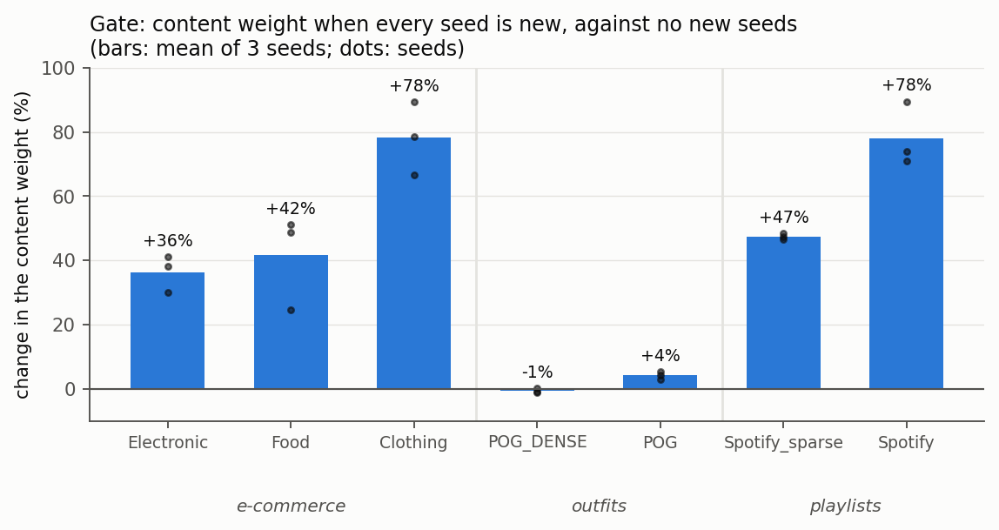

**What is compared.** The content weight $w_C$ for a query whose seeds are all new (never bundled), against one with no
new seeds. The other gate inputs are set to a typical query.

**Why it should change.** A never-bundled seed has no co-occurrence counts and no partner history, so the graph part
has nothing to say about it. Only content and labels are left.

**What it shows.** The gate learned this on e-commerce (+36% to +78%) and playlists (+47%, +78%), where 53% to 80% of
validation queries have at least one new seed. On outfits the weight barely changes (−1%, +4%), although new seeds are
common there too (41% and 70% of validation queries).

**How much it matters:** 10% and 13% on playlists, 0 to 1% elsewhere.

### 2.8 All the parts side by side

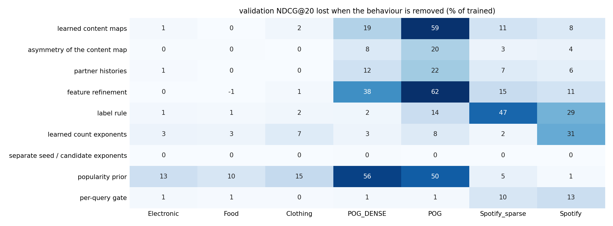

**How to read it.** Each cell is the validation NDCG@20 lost when that one learned pattern is removed from the trained
model (for example, $\delta$ put back to 0), as a percentage of the trained model's score, averaged over the three
seeds. Darker means the pattern matters more there.

**What it shows.** Each domain relies on different parts:

- **E-commerce:** mostly the popularity prior (10 to 15%). Everything else is small.
- **Outfits:** the prior, the refined features and the learned content matrices, with partner histories and the taste
  on top.
- **Playlists:** the label rule first (47%, 29%), then the content matrices, refined features and the gate. On full
  Spotify the count exponents matter too (31%).

The row "learned count exponents" puts the exponents back to ½ while $\rho$ stays. The two share the graph part and
are scaled together, so this row also changes how much $\rho$ counts. Measured with $\rho$ removed first, the exponents
alone are worth −1 to 1% in e-commerce, 16% and 6% on outfits, and 13% and 5% on playlists (TRIAD_DESIGN.md §3.3).

---

## Part 3. Results

### 3.1 TRIAD against the best simple baseline: all, warm and cold queries

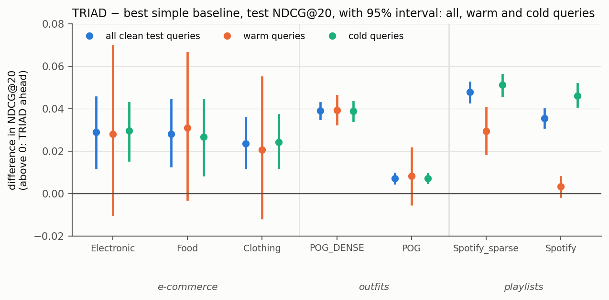

**How to read it.** Each dot is TRIAD's test NDCG@20 minus the best simple baseline's, on clean test queries, and the
line through it is the 95% interval. Above 0 means TRIAD is ahead. If the line does not cross 0, the difference is
clearly not chance (RESULTS.md has the corrected p-values).

- **Blue, all queries:** TRIAD is ahead on all seven datasets (RESULTS.md §2).
- **Orange, warm queries:** every seed and every hidden item was in some training bundle.
- **Aqua, cold queries:** at least one seed or hidden item was never in a training bundle.

**What it shows.**

- Most test queries are cold. Only 7% to 38% are warm, depending on the dataset.
- On **cold** queries TRIAD is ahead on every dataset, and every interval stays above 0.
- On **warm** queries TRIAD is ahead on average everywhere, but the intervals are wide where the warm groups are small
  (e-commerce and POG, 65 to 298 queries). On full Spotify, with 997 warm queries, the lead is close to 0 (+.003): there,
  TRIAD's lead comes from the cold queries.

### 3.2 Fewer seeds

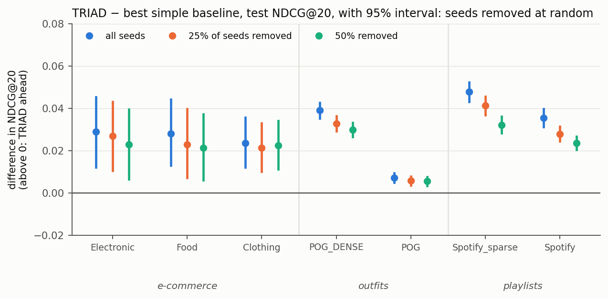

**How to read it.** The same difference, but now each seed of every test query was dropped at random with probability
25% (orange) or 50% (aqua), keeping at least one. The hidden items stay the same, and both methods get the same reduced
queries.

**What it shows.** TRIAD stays ahead at both rates on all seven datasets. The lead shrinks a little as seeds are
removed (Spotify_sparse: +.048, +.041, +.032), so TRIAD gains somewhat more from extra seeds than the baseline does.
Many e-commerce and POG queries have only one or two seeds and one is always kept, so there the removal changed fewer
queries than the rate suggests (RESULTS.md §6).

---

## Summary: what TRIAD learned, per domain

| | E-commerce | Outfits | Playlists |
|---|---|---|---|
| shared label (2.2) | bonus for small categories | **penalty**, stronger for big categories | **bonus**, stronger for niche artists |
| content (2.4) | look-alikes go together | look-alikes do not; content changes a lot | in between |
| partner histories (2.5) | little use | half to two thirds of content | about two thirds of content |
| popularity discount (2.3) | weaker than cosine | weaker than cosine | almost none (raw counts) |
| prior (2.1) | the most important part | very important, with a dip at $f=1$ | follows the base rate, small effect |
| new seeds (2.7) | more weight on content | no change | more weight on content |

The model starts as a simple scorer (plain similarity plus cosine co-occurrence) and every one of these patterns is a
learned departure from it. Which departures matter depends on the domain, so no single fixed scorer suits all three.
